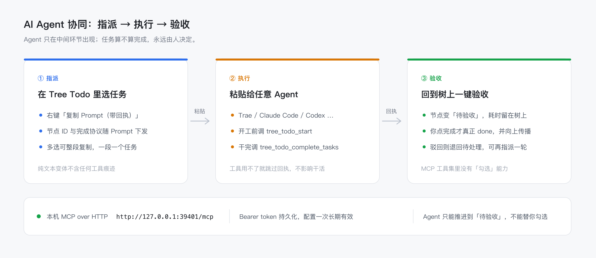
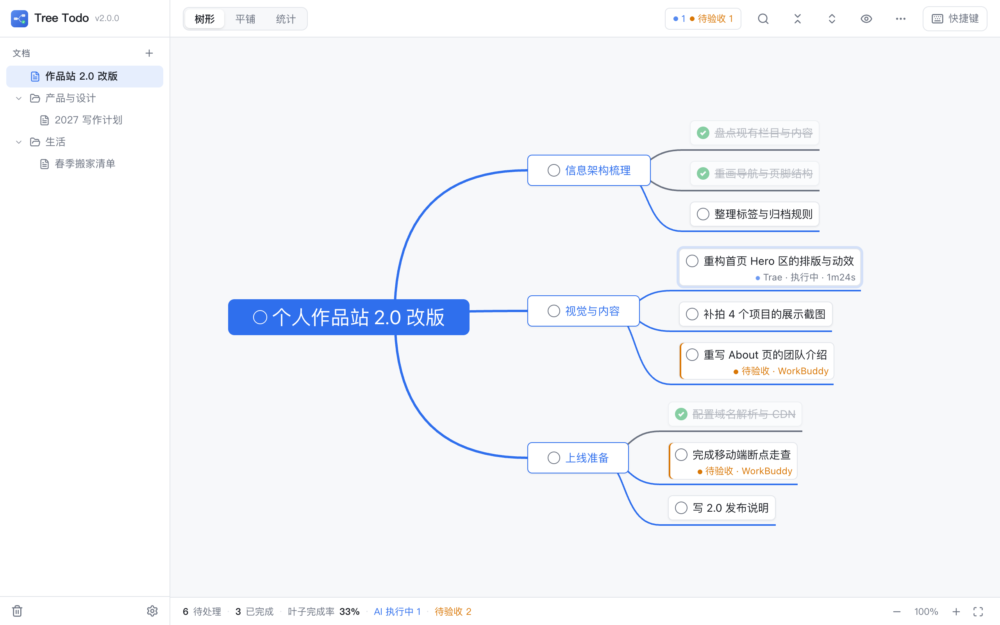
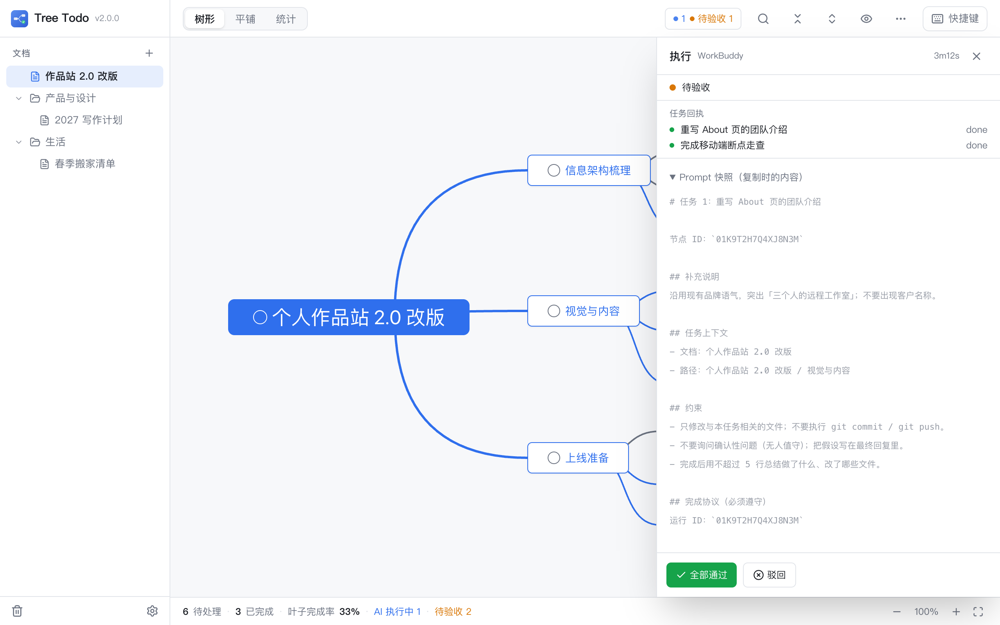

<div align="center">
  

  <h1>Tree Todo</h1>

  <p><b>把待办写成树，让进度自己往上长。</b></p>

  <p>
    无限层级拆解 · 状态自动传播 · 树形 / 平铺双视图 · <b>AI Agent 协同</b> · 本地优先<br />
    Windows / macOS 桌面应用（Tauri 2 + Rust + React）
  </p>

  <p>
    <a href="LICENSE"></a>
    
    
    <a href="https://github.com/Jeysin/tree-todo/releases/latest"></a>
  </p>
</div>

<br />


> 截图中的任务树为演示数据。

---

## 它解决什么问题

你的待办清单大概率长这样：40 条任务平铺在一个列表里。
「改版首页」和「给客户回邮件」并排躺着，看不出谁属于哪个目标，也算不出一条任务线到底还剩多少活。

于是你换成脑图：结构终于清楚了，但节点没有状态。
做完一个子任务，要自己回去把父节点也勾掉；新增一条子任务，又忘了把父节点改回未完成。**结构工具和状态工具，是两套东西。**

Tree Todo 把这两件事合成一个动作：

> **结构用树表达，进度用传播维护。**

| 你现在的做法 | 卡在哪 |
| --- | --- |
| 平铺待办清单 | 层级只能靠缩进假装，几十条之后看不出从属关系，也回答不了「这条线还差多少」 |
| 专业脑图工具 | 结构清楚，但节点没有 pending / done，父节点进度全靠手动同步，迟早对不上 |
| 项目管理 SaaS | 重、要联网、要账号；一个人的任务不值得为它开一套系统 |

使用树形待办，解决你所有的卡点，并且基于「待办即Prompt」的设计理念，树上的任务可以直接交给 AI Agent 去执行，执行状态会通过MCP回调的方式同步回Tree Todo中，哪个节点正在执行、哪个节点待验收，一目了然。

## 核心功能

### 1. 树形视图：任务拆到哪一层都不乱

- 水平脑图布局，根在左、子任务向右生长，一眼看清目标与子任务的从属关系
- 任意节点可以继续拆子节点，层级不设上限；节点文字自动折行，不截断
- 触控板双指平移 / 捏合缩放（10%–400%），`Shift+1` 一键适应整棵树
- 折叠角标收拢支线，`Ctrl+1` 与平铺视图来回切

### 2. 状态自动传播：你只需要勾叶子

这是整个产品的核心。规则只有四条：

| 你的操作 | 会发生什么 |
| --- | --- |
| 勾掉一个父任务 | 整条支线一起完成（级联向下） |
| 子任务全部完成 | 父任务自动完成，并一路向上传播 |
| 在已完成的任务下新增子任务 | 该任务自动退回「待处理」 |
| 取消任意一个子任务 | 所有祖先链重新变回「待处理」 |

所以你永远不需要回答「父任务该不该勾」——树的形状本身就是进度的真相。
已完成节点会划线、降透明度，整条连线变灰，一眼看出「这条支线走完了」。

> 实现上，传播只在 Rust 侧发生，且与数据写入在同一个事务里；前端只持有渲染快照。
> 这保证了快速连点、连续新建时状态不会错乱，也不会出现「界面勾了、库里没写」。

### 3. 平铺视图：只看「还有哪些活」


- 只列**叶子任务**（可直接执行的原子事项），中间的容器节点不重复出现
- 左栏待处理按树的深度优先顺序排列，同一任务线的叶子挨在一起；右栏已完成按完成时间倒序
- 每条都带面包屑路径（`Tree Todo v2.0 发布 / 发布准备 / macOS 公证与签名`），点一下跳回树里定位并高亮
- 已完成条目显示「今天 / 昨天 / 10月31日」，待验收的条目单独计数

### 4. AI Agent 协同：待办即Prompt，一键复制给Agent执行，验收权留给你



- 右键「复制 Prompt（带回执）」，粘给 Trae / Claude Code / Codex / 任意支持 MCP 的 Agent
- Agent 开工前调 `tree_todo_start`，节点自动亮起「执行中 · 计时」；收工调 `tree_todo_complete_tasks`，节点变「待验收」
- **MCP 工具集里没有任何「勾选」能力**——Agent 最多把任务推到待验收，done 只能由你点
- 多选整段复制、同一批节点重复复制复用同一个 run、24 小时没开工的派发自动过期
- 本机服务（`127.0.0.1:39401`）+ 持久 token，配置一次长期有效



顶栏的「执行中 / 待验收」计数就是入口。点开就是这一轮的运行抽屉：Agent、总耗时、逐节点回执与 Prompt 快照都在里面，验收也在这里完成。



完整接入步骤见 [用 AI Agent 干活：三步接入](#用-ai-agent-干活三步接入)。

> 截图中的任务树、Agent 名称与回执均为演示数据。

### 5. 多文档 + 目录：多条任务线互不打扰


- 每个文档是一棵独立的树，对应磁盘上一个独立的 SQLite 文件
- 目录可无限嵌套，右键即可新建文档 / 子目录、导出、移动到、重命名、删除
- 拖拽调整同级顺序、拖进目录，或把条目拖到列表空白处移回根层级；悬停在折叠的目录上会先自动展开，防环由 Rust 侧二次校验
- 侧边栏宽度可拖拽，目录展开状态按目录记忆

### 6. 键盘流：全程不用碰鼠标


`N` 新建 → 输入 → `Tab` 拆子任务 → 输入 → `Enter` 加同级 → `S` 勾完成。
一条任务线可以在十几秒内建完，手不用离开键盘。`⌘F` 搜索、`⌘Z` 撤销、`⌘1/2/3` 切视图都在指尖；
派活给 Agent 也只差一次 `⌘⇧R`。

### 7. 搜索与定位


`⌘F` 打开搜索浮层，同时匹配任务内容与备注，↑↓ 选择、`Enter` 跳转——自动展开祖先路径、滚入视口并高亮。

### 8. 统计：这条线到底走了多远


按任务线统计叶子总数、待处理 / 已完成、完成率和最近 7 天完成量。看的是「可执行事项」的真实进度，而不是被容器节点稀释过的百分比。

### 9. 隐藏已完成：只看还欠着的


顶栏的小眼睛按钮，一键收起所有已完成节点及其子树（根任务始终保留），并**按文档各自记忆**开关状态。任务很多时，这是最快的「聚焦」手段。

### 10. 回收站与撤销：删错了能回来


- 删除的文档 / 整个目录进入回收站，可恢复、彻底删除或清空；目录恢复时结构与文档归属原样还原
- 回收站支持按天自动清理（默认 30 天，0 = 关闭），设置页可改；待验收的记录不会被清掉
- 节点删除是即时物理删除，但 `⌘Z` 立刻回来——所有变更类操作都有历史记录（100 步）
- 拖拽改父子关系、`Alt+↑/↓` 调同级顺序，防环由 Rust 侧二次校验

### 11. 明暗主题


跟随系统 / 浅色 / 深色，随时切换。

### 12. 数据就在你自己的硬盘上

- 每个文档一个 SQLite 文件，**每次操作即事务写入**，没有「保存」按钮，关掉就完事
- 无账号、无联网、无遥测；复制数据目录即完整备份
- 支持把「当前文档 / 某个目录 / 全部」导出成一个 `.json` 文件，导入即整体还原（适合换机与归档）

### 13. 自动更新：新版本不用自己找

- 启动时自动检查 GitHub Releases；有新版本弹窗展示版本号与更新说明
- 也可以点左上角版本号，或系统菜单「检查更新…」手动检查；没有新版本会提示「已是最新版本」
- Windows 可直接在应用内下载安装并重启；macOS 会打开 Releases 下载页（暂未签名公证）
- 更新只替换程序，文档、目录、回收站与执行记录都不动

## 用 AI Agent 干活：三步接入

> 适用于任何支持 MCP 的 Agent（Trae、Claude Code、Codex、Cursor…）。
> 不支持 MCP 也能用——右键「复制 Prompt」拿纯文本变体，只是少了「执行中 / 待验收」这两盏灯。

### ① 配好 MCP（一次就够）

设置（侧边栏底部的齿轮）→ **MCP 集成** → 选目标 Agent → **复制 MCP 配置**，粘进 Agent 的 MCP 设置：

```json
{
  "mcpServers": {
    "tree-todo": {
      "url": "http://127.0.0.1:39401/mcp",
      "headers": {
        "Authorization": "Bearer <设置页里那串 token>",
        "X-Tree-Todo-Agent": "Trae"
      }
    }
  }
}
```

- 服务只监听本机回环地址，token 持久化在数据目录的 `mcp.json` 里，重启后配置依然有效
- 端口被占用时会自动 +1 并提示重新复制；点「重置 token」会让旧配置立刻失效
- `X-Tree-Todo-Agent` 决定节点徽标上显示谁在执行（Trae / Claude Code / Codex…）

### ② 复制 Prompt

在树里右键任务 →「复制 Prompt（带回执）」（`⌘⇧R` / `Ctrl+Shift+R`）。

多选后右键则**整段复制**：每个节点一段 `# 任务 N`，所有段落共用一个 runId；右键点在选区内时，动作作用于整个选区。
父节点的 Prompt 只列**待处理**的子任务，已完成 / 正在执行 / 待验收的不会重复派给 Agent。

Agent 收到的东西长这样（节选）：

```text
# 任务：重构导出流程，支持按目录导出

节点 ID：`01JBQ7K3...`

## 任务上下文
- 文档：产品需求收集
- 路径：Tree Todo v2.0 发布 / 发布准备

## 子任务（全部完成后本任务才算完成）
- [ ] 抽出打包函数
- [ ] 补单元测试
- [ ] 更新 docs/03

## 完成协议（必须遵守）
运行 ID：`01JBQ7K3...`

本次需要回执的节点：
- `01JBQ7K3...` 重构导出流程，支持按目录导出

1. **开始执行前**，先调用 MCP 工具 `tree_todo_start`：
   `{"run_id":"01JBQ7K3...","agent_name":"<你的产品名称，如 Claude Code / Trae>"}`
   ——任务将标记为「执行中」并开始计时。
2. **全部完成后**，调用 MCP 工具 `tree_todo_complete_tasks`：
   `{"run_id":"01JBQ7K3...","tasks":[{"id":"01JBQ7K3...","result":"done","summary":"一句话说明"}]}`
   ——任务将进入「待验收」，是否完成由用户验收决定。
3. 若上述工具不可用（tree-todo 未运行或未配置其 MCP server），直接完成任务即可，无需回执。
4. 任何时候都不要试图替用户「完成 / 勾选」任务。
```

Prompt 里的「约束」段可以在设置页改（每行一条），默认是这条链路上踩过坑之后总结出来的几条规矩。

### ③ 粘给 Agent，回树上验收

| 时机 | Agent 调用 | 节点变化 |
| --- | --- | --- |
| 开始动手 | `tree_todo_start` | 「执行中 · 1m20s」，秒表开始走 |
| 全部做完 | `tree_todo_complete_tasks` | 「待验收 · Trae」，秒表停住 |

顶栏会出现「待验收 N」徽标，点开运行抽屉能看到这一轮的 Agent、总耗时、Prompt 快照，以及每个节点的回执与摘要。

回到树上验收，两条路都行：

- **通过** → 抽屉里点「全部通过」，或直接在树上勾掉节点（`S`）。两者走的是同一条传播事务：子任务全完成，父任务自动完成并一路向上
- **驳回** → 写一句驳回原因（会写回节点备注），节点退回「待处理」，改完再复制一轮；旧回执作废，不会跟新一轮混在一起
- **Agent 卡住了** → 执行中的计时不会自动停，看到「2h35m」就说明该介入了，抽屉里可以「标记结束」手动收口

| MCP 工具 | 谁调 | 作用 |
| --- | --- | --- |
| `tree_todo_start` | Agent | 节点置「执行中」并开始计时 |
| `tree_todo_complete_tasks` | Agent | 节点置「待验收」/「失败」并停表，附带一句话摘要 |

> **验收权是物理隔离的**：MCP 工具集里没有任何写任务状态的能力，Agent 最多把任务推到「待验收」。
> 这是代码层的红线，不是提示词里的君子协定——细节见 [`docs/06-agent-integration.md`](docs/06-agent-integration.md)。

### 为什么是「复制粘贴」而不是自动派发

1.0 试过由宿主拉起 Agent CLI 子进程直接派活，三条路都堵：个人版 Agent 没有 CLI；有 CLI 的，执行目录与模型参数各家不同且随版本漂移；退出码甚至会骗人（认证失败仍返回 0）。

2.0 把这条链路整体删掉，只留两样真正稳定的东西：**一段可以粘贴的 Prompt，一个本机 MCP 端点**。
谁执行、用什么模型、在哪个目录，交给你在 Agent 那边决定；Tree Todo 只负责「任务从哪来」和「完成由谁说了算」。

## 适用场景

| 场景 | 怎么用 |
| --- | --- |
| **独立开发 / 一人公司** | 产品线 → 版本 → 功能 → 具体改动，几条线并行也看得清哪条堵着 |
| **把活派给 AI** | 拆到叶子 → 复制带回执的 Prompt → 粘给 Agent → 回树上一键验收，进度和耗时都留在树上 |
| **内容创作** | 选题 → 提纲 → 素材 → 发布，一篇文章就是一棵小树 |
| **学习与考试** | 科目 → 章节 → 知识点，勾完一章自动收掉上层进度 |
| **生活项目** | 搬家、婚礼、长途旅行准备——事项多、有依赖、要能随时看还剩多少 |
| **目标拆解** | 年度目标 → 季度 KR → 本周行动项，配统计面板看推进节奏 |

## 和其他工具的区别

| | 结构表达 | 任务状态 | 离线 / 本地 | 上手成本 |
| --- | :---: | :---: | :---: | --- |
| 平铺待办 App | 弱（缩进） | 强 | 多数要账号 | 低 |
| 专业脑图工具 | 强 | 弱（无 pending / done） | 视产品而定 | 中 |
| 项目管理 SaaS | 中 | 强 | 否 | 高 |
| **Tree Todo** | **强** | **强（自动传播）** | **是（单机 SQLite）** | **低** |

还有一条差别在 AI 上：别的工具让 Agent 直接改任务状态，Tree Todo 只让 Agent 汇报到「待验收」。
**执行的可以外包，验收不行。**

## 快速开始

### 直接下载

到 [Releases](https://github.com/Jeysin/tree-todo/releases) 下载对应平台的安装包：

| 平台 | 文件 |
| --- | --- |
| macOS（Universal，Apple Silicon + Intel） | `Tree Todo_2.0.0_universal.dmg` |
| Windows（x64） | `Tree Todo_2.0.0_x64-setup.exe` |

> 安装包尚未做代码签名与公证：macOS 首次打开请右键「打开」，或到「系统设置 → 隐私与安全性」中允许；
> Windows 若提示 SmartScreen，点「更多信息 → 仍要运行」。
>
> 安装后无需再手动找新版本：应用启动时自动检查，也可点左上角版本号或菜单「检查更新…」。
> Windows 支持应用内下载安装并重启；macOS 暂跳转 Releases 下载页。
>
> 1.0.0 用户需手动安装一次 2.0.0（旧版本不含更新能力）；从 2.0.0 起才能自动升级。

### 从源码构建

#### 环境要求

| 工具 | 版本 | 说明 |
| --- | --- | --- |
| Node.js | ≥ 22 | 前端构建 |
| pnpm | ≥ 9 | 包管理器 |
| Rust | stable（支持 edition 2024，≥ 1.85） | 后端与打包 |
| macOS | Xcode Command Line Tools | `xcode-select --install` |
| Windows | MSVC 生成工具 + WebView2 Runtime | Win11 自带 WebView2，Win10 需单独安装 |

#### 构建与运行

```bash
git clone https://github.com/Jeysin/tree-todo.git
cd tree-todo

pnpm install        # 安装前端依赖
pnpm tauri dev      # 开发模式（前端热更新）

pnpm tauri build    # 打包当前平台的安装包
```

> 打包开启了自动更新的产物签名（`createUpdaterArtifacts`），本地执行 `pnpm tauri build`
> 需要提供 `TAURI_SIGNING_PRIVATE_KEY`（见 `docs/08-auto-update.md` §4.4）；
> 只构建不打包可用 `pnpm tauri build --no-bundle`。

产物在 `src-tauri/target/release/bundle/`：

- **macOS**：`macos/Tree Todo.app`、`dmg/Tree Todo_<version>_<arch>.dmg`
- **Windows**：`nsis/Tree Todo_<version>_x64-setup.exe`

首次编译需要 3–10 分钟（Rust 依赖全量构建），之后增量编译只要几秒。

### 数据存放位置

| 平台 | 路径 |
| --- | --- |
| macOS | `~/Library/Application Support/com.jeysin.treetodo/` |
| Windows | `%APPDATA%\com.jeysin.treetodo\` |

目录里 `documents.json` 是文档索引，`docs/<id>.db` 是每个文档的数据，`trash/` 是回收站，
`mcp.json` 是 MCP 服务的端口与 token。

## 快捷键

macOS 用 `⌘`，Windows 用 `Ctrl`。

| 操作 | 键位 | 操作 | 键位 |
| --- | --- | --- | --- |
| 在根任务下新建 | `N` | 新建子任务 | `Tab` |
| 新建同级任务 | `Enter` | 编辑节点 | `F2` / 双击 |
| 完成 / 取消完成 | `S` | 删除节点 | `Delete` |
| 撤销 / 重做 | `⌘Z` / `⇧⌘Z` | 搜索 | `⌘F` |
| 树形 / 平铺 / 统计 | `⌘1` / `⌘2` / `⌘3` | 适应视图 | `⇧1` |
| 折叠 / 展开节点 | `⌘.` / `⌘,` | 同级上移 / 下移 | `Alt+↑` / `Alt+↓` |
| 复制 Prompt | `⌘⇧C` | 复制 Prompt（带回执） | `⌘⇧R` |
| 节点详情 | `Alt+Enter` | 平移画布 | `Space` + 拖拽 |

## 技术栈

| 层 | 选型 |
| --- | --- |
| 桌面框架 | Tauri 2（macOS 应用包仅约 6 MB，内存占用远低于 Electron） |
| 前端 | React 19 + TypeScript（strict）+ Vite + Tailwind CSS 4 + Zustand 5 |
| 树渲染 | Mind Elixir 5（布局 / 缩放 / 拖拽 / 折叠 / 键盘导航） |
| 后端 | Rust（edition 2024）+ rusqlite（内置 SQLite） |
| 状态核心 | `src-tauri/src/propagate.rs`——纯逻辑的传播引擎，单测覆盖全部规则与边界用例 |
| Agent 协同 | 本机 HTTP MCP server（`runtime/`）+ Prompt 组装（`agents/`），回执落库与节点同事务 |

```
src/                  React 前端
  components/         侧边栏、顶栏、状态栏、运行抽屉、Toast
  views/tree/         树形（脑图）视图
  views/flat/         平铺视图
  views/stats/        统计视图
  views/trash/        回收站
  stores/             Zustand（只存渲染快照）
  ipc/                Tauri command 的唯一 TS 出口
src-tauri/src/
  commands/           IPC 命令（校验 + 委托）
  db/                 SQLite 访问与迁移
  propagate.rs        状态传播引擎
  history.rs          撤销 / 重做（快照式回放）
  storage.rs          多文档、目录与回收站
  agents/             Prompt 组装 + MCP 工具集
  runtime/            本机 MCP 服务（固定端口 + 持久 token）
docs/                 需求 / 数据模型 / 交互 / UI / 路线图 / Agent 协同
```

设计上的一个取舍：**领域规则只在 Rust 实现一次，前端不做任何状态推导**。
所有变更命令走「写入 + 级联 + 向上传播」的同一事务，返回受影响的子树快照，前端合并即可。
规则表与 8 个边界用例写在 [`docs/02-data-model.md`](docs/02-data-model.md)；
Agent 侧的二阶段回执与验收权红线写在 [`docs/06-agent-integration.md`](docs/06-agent-integration.md)。

## 参与贡献

- 发现问题或有想法：直接开 [Issue](../../issues)，附上复现步骤或截图
- 提 PR 前请先读 [`AGENTS.md`](AGENTS.md)（代码规范）与 [`docs/02-data-model.md`](docs/02-data-model.md)（领域规则红线）
- 提交前本地跑通：

```bash
cargo test                                   # 传播引擎单测必须全绿
cargo clippy --all-targets -- -D warnings    # 零警告
pnpm build                                   # 类型检查 + 前端构建
```

## License

[MIT](LICENSE) © 2026 jeysin
