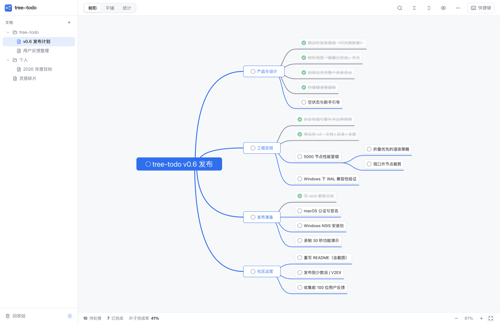
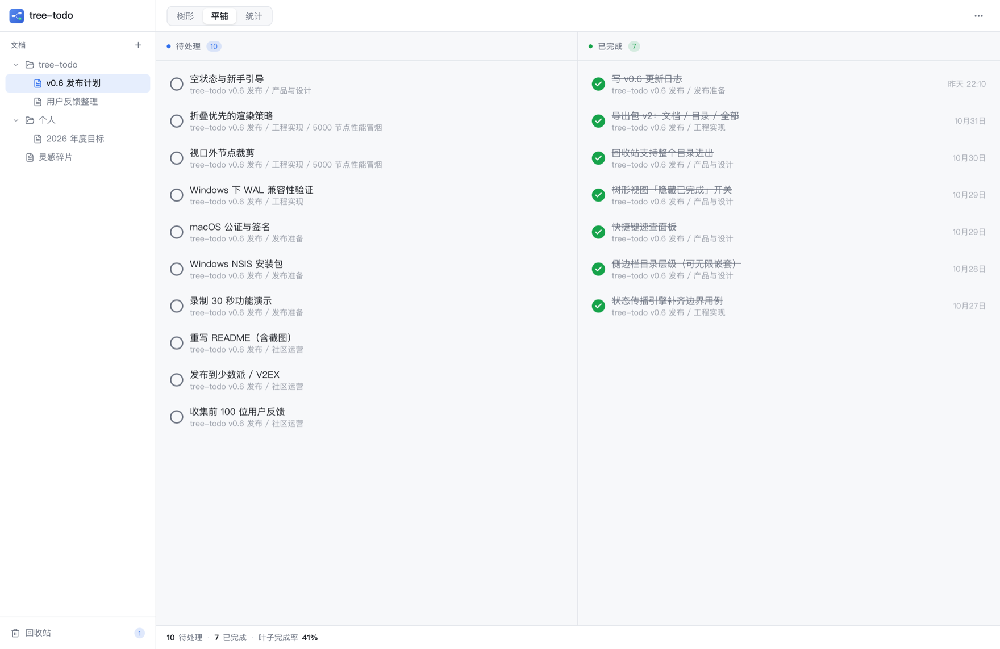
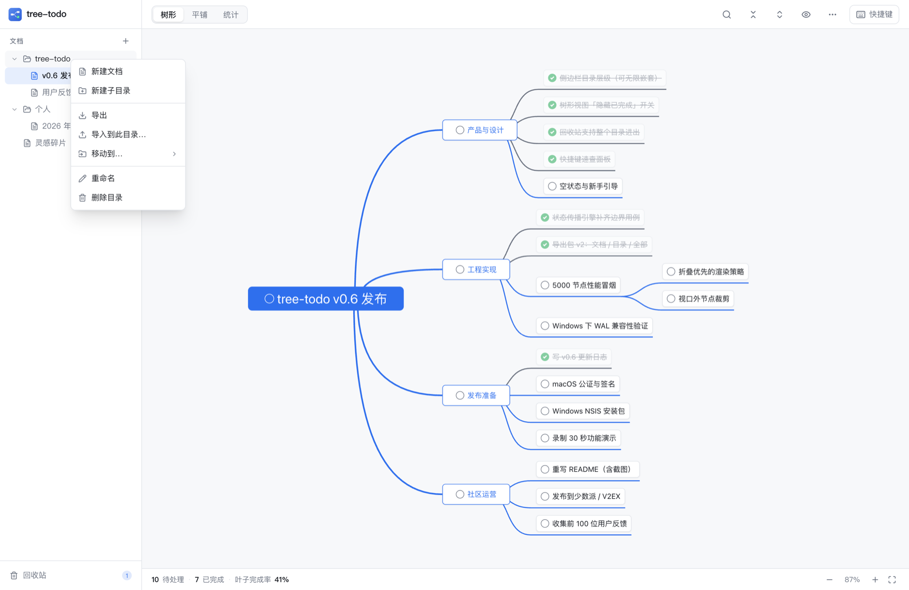
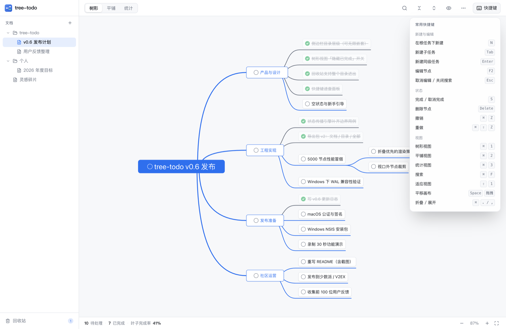
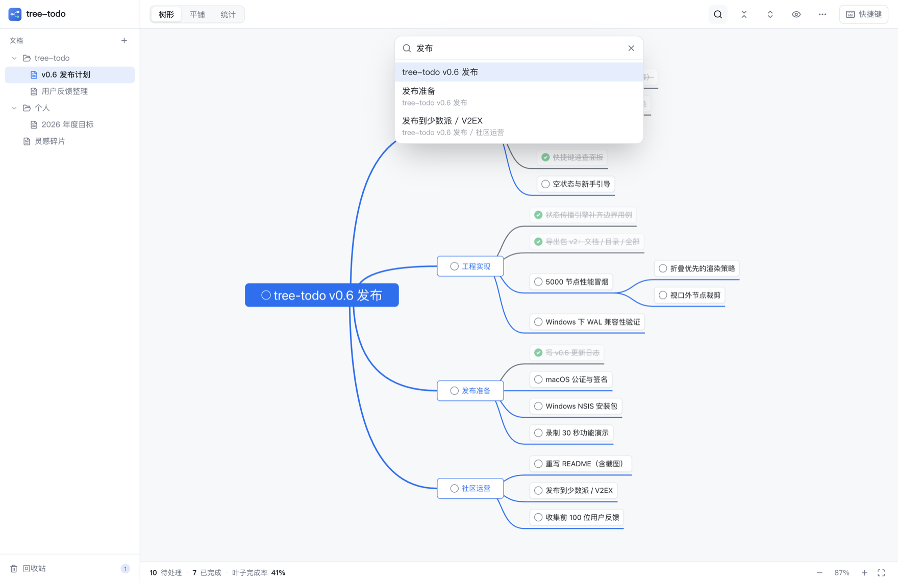
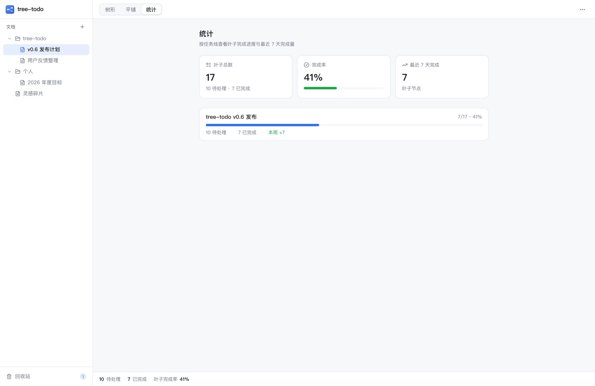
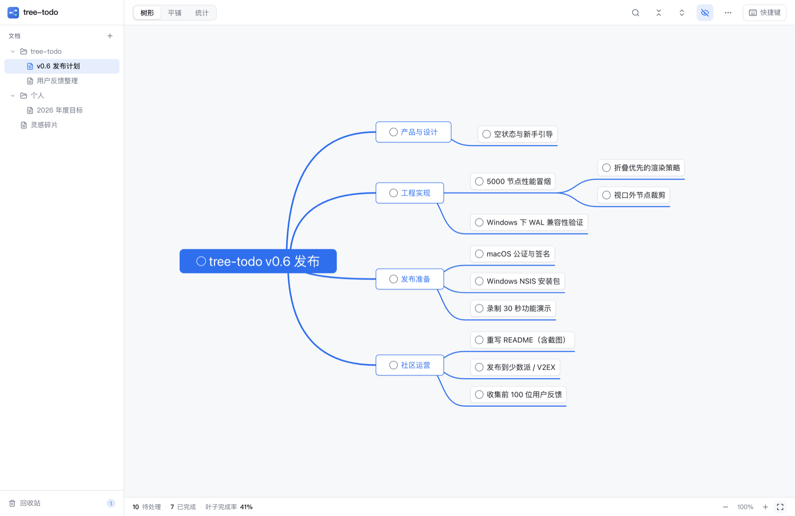
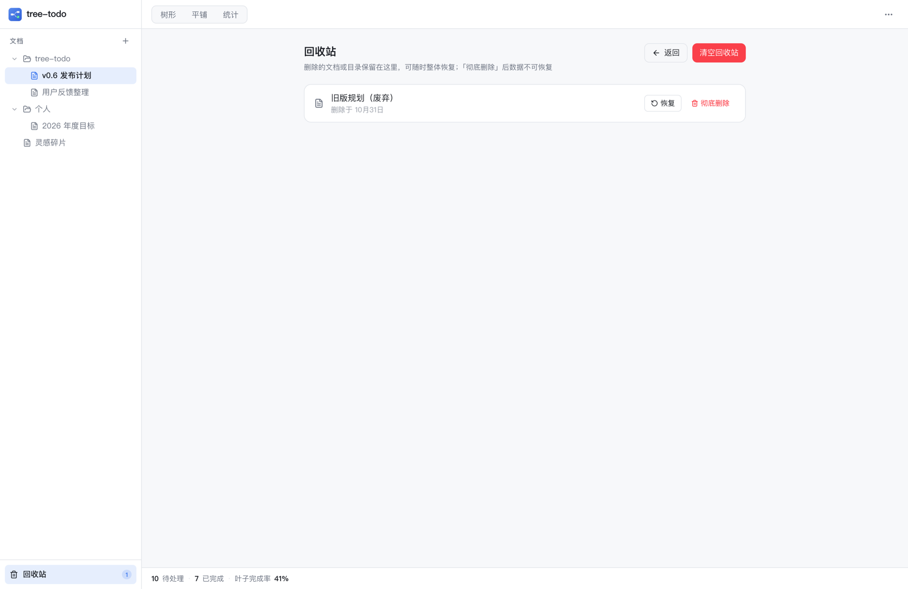
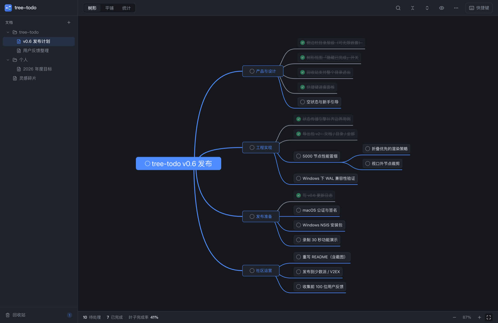

<div align="center">
  

  <h1>tree-todo</h1>

  <p><b>把待办写成树，让进度自己往上长。</b></p>

  <p>
    无限层级拆解 · 状态自动传播 · 树形 / 平铺双视图 · 本地优先<br />
    Windows / macOS 桌面应用（Tauri 2 + Rust + React）
  </p>

  <p>
    <a href="LICENSE"></a>
    
    
    
  </p>
</div>

<br />



> 截图中的任务树为演示数据。

---

## 它解决什么问题

你的待办清单大概率长这样：40 条任务平铺在一个列表里。
「改版首页」和「给客户回邮件」并排躺着，看不出谁属于哪个目标，也算不出一条任务线到底还剩多少活。

于是你换成脑图：结构终于清楚了，但节点没有状态。
做完一个子任务，要自己回去把父节点也勾掉；新增一条子任务，又忘了把父节点改回未完成。**结构工具和状态工具，是两套东西。**

tree-todo 把这两件事合成一个动作：

> **结构用树表达，进度用传播维护。**

| 你现在的做法 | 卡在哪 |
| --- | --- |
| 平铺待办清单 | 层级只能靠缩进假装，几十条之后看不出从属关系，也回答不了「这条线还差多少」 |
| 专业脑图工具 | 结构清楚，但节点没有 pending / done，父节点进度全靠手动同步，迟早对不上 |
| 项目管理 SaaS | 重、要联网、要账号；一个人的任务不值得为它开一套系统 |

## 核心功能

### 1. 树形视图：任务拆到哪一层都不乱

- 水平脑图布局，根在左、子任务向右生长，一眼看清目标与子任务的从属关系
- 任意节点可以继续拆子节点，层级不设上限；节点文字自动折行，不截断
- 触控板双指平移 / 捏合缩放（10%–400%），`Shift+1` 一键适应整棵树
- 折叠角标收拢支线，`Ctrl+1` 与平铺视图来回切

### 2. 状态自动传播：你只需要勾叶子

这是整个产品的核心。规则只有四条：

| 你的操作 | 会发生什么 |
| --- | --- |
| 勾掉一个父任务 | 整条支线一起完成（级联向下） |
| 子任务全部完成 | 父任务自动完成，并一路向上传播 |
| 在已完成的任务下新增子任务 | 该任务自动退回「待处理」 |
| 取消任意一个子任务 | 所有祖先链重新变回「待处理」 |

所以你永远不需要回答「父任务该不该勾」——树的形状本身就是进度的真相。
已完成节点会划线、降透明度，整条连线变灰，一眼看出「这条支线走完了」。

> 实现上，传播只在 Rust 侧发生，且与数据写入在同一个事务里；前端只持有渲染快照。
> 这保证了快速连点、连续新建时状态不会错乱，也不会出现「界面勾了、库里没写」。

### 3. 平铺视图：只看「还有哪些活」



- 只列**叶子任务**（可直接执行的原子事项），中间的容器节点不重复出现
- 左栏待处理按树的深度优先顺序排列，同一任务线的叶子挨在一起；右栏已完成按完成时间倒序
- 每条都带面包屑路径（`tree-todo v0.6 发布 / 发布准备 / macOS 公证与签名`），点一下跳回树里定位并高亮
- 已完成条目显示「今天 / 昨天 / 10月31日」

### 4. 多文档 + 目录：多条任务线互不打扰



- 每个文档是一棵独立的树，对应磁盘上一个独立的 SQLite 文件
- 目录可无限嵌套，右键即可新建文档 / 子目录、导出、移动到、重命名、删除
- 侧边栏宽度可拖拽，目录展开状态按目录记忆

### 5. 键盘流：全程不用碰鼠标



`N` 新建 → 输入 → `Tab` 拆子任务 → 输入 → `Enter` 加同级 → `S` 勾完成。
一条任务线可以在十几秒内建完，手不用离开键盘。`⌘F` 搜索、`⌘Z` 撤销、`⌘1/2/3` 切视图都在指尖。

### 6. 搜索与定位



`⌘F` 打开搜索浮层，同时匹配任务内容与备注，↑↓ 选择、`Enter` 跳转——自动展开祖先路径、滚入视口并高亮。

### 7. 统计：这条线到底走了多远



按任务线统计叶子总数、待处理 / 已完成、完成率和最近 7 天完成量。看的是「可执行事项」的真实进度，而不是被容器节点稀释过的百分比。

### 8. 隐藏已完成：只看还欠着的



顶栏的小眼睛按钮，一键收起所有已完成节点及其子树（根任务始终保留），并**按文档各自记忆**开关状态。任务很多时，这是最快的「聚焦」手段。

### 9. 回收站与撤销：删错了能回来



- 删除的文档 / 整个目录进入回收站，可恢复、彻底删除或清空；目录恢复时结构与文档归属原样还原
- 节点删除是即时物理删除，但 `⌘Z` 立刻回来——所有变更类操作都有历史记录（100 步）
- 拖拽改父子关系、`Alt+↑/↓` 调同级顺序，防环由 Rust 侧二次校验

### 10. 明暗主题



跟随系统 / 浅色 / 深色，随时切换。

### 11. 数据就在你自己的硬盘上

- 每个文档一个 SQLite 文件，**每次操作即事务写入**，没有「保存」按钮，关掉就完事
- 无账号、无联网、无遥测；复制数据目录即完整备份
- 支持把「当前文档 / 某个目录 / 全部」导出成一个 `.json` 文件，导入即整体还原（适合换机与归档）

## 适用场景

| 场景 | 怎么用 |
| --- | --- |
| **独立开发 / 一人公司** | 产品线 → 版本 → 功能 → 具体改动，几条线并行也看得清哪条堵着 |
| **内容创作** | 选题 → 提纲 → 素材 → 发布，一篇文章就是一棵小树 |
| **学习与考试** | 科目 → 章节 → 知识点，勾完一章自动收掉上层进度 |
| **生活项目** | 搬家、婚礼、长途旅行准备——事项多、有依赖、要能随时看还剩多少 |
| **目标拆解** | 年度目标 → 季度 KR → 本周行动项，配统计面板看推进节奏 |

## 和其他工具的区别

| | 结构表达 | 任务状态 | 离线 / 本地 | 上手成本 |
| --- | :---: | :---: | :---: | --- |
| 平铺待办 App | 弱（缩进） | 强 | 多数要账号 | 低 |
| 专业脑图工具 | 强 | 弱（无 pending / done） | 视产品而定 | 中 |
| 项目管理 SaaS | 中 | 强 | 否 | 高 |
| **tree-todo** | **强** | **强（自动传播）** | **是（单机 SQLite）** | **低** |

## 快速开始

> 当前版本 **v1.0.0**。安装包尚未做代码签名与公证，首次打开时可能需要在系统「隐私与安全性」里手动允许；
> 也可以直接按下面的步骤从源码构建。

### 环境要求

| 工具 | 版本 | 说明 |
| --- | --- | --- |
| Node.js | ≥ 22 | 前端构建 |
| pnpm | ≥ 9 | 包管理器 |
| Rust | stable（支持 edition 2024，≥ 1.85） | 后端与打包 |
| macOS | Xcode Command Line Tools | `xcode-select --install` |
| Windows | MSVC 生成工具 + WebView2 Runtime | Win11 自带 WebView2，Win10 需单独安装 |

### 构建与运行

```bash
git clone https://github.com/jeysin/tree-todo.git
cd tree-todo

pnpm install        # 安装前端依赖
pnpm tauri dev      # 开发模式（前端热更新）

pnpm tauri build    # 打包当前平台的安装包
```

产物在 `src-tauri/target/release/bundle/`：

- **macOS**：`macos/tree-todo.app`、`dmg/tree-todo_<version>_<arch>.dmg`
- **Windows**：`nsis/tree-todo_<version>_x64-setup.exe`

首次编译需要 3–10 分钟（Rust 依赖全量构建），之后增量编译只要几秒。

### 数据存放位置

| 平台 | 路径 |
| --- | --- |
| macOS | `~/Library/Application Support/com.jeysin.treetodo/` |
| Windows | `%APPDATA%\com.jeysin.treetodo\` |

目录里 `documents.json` 是文档索引，`docs/<id>.db` 是每个文档的数据，`trash/` 是回收站。

## 快捷键

macOS 用 `⌘`，Windows 用 `Ctrl`。

| 操作 | 键位 | 操作 | 键位 |
| --- | --- | --- | --- |
| 在根任务下新建 | `N` | 新建子任务 | `Tab` |
| 新建同级任务 | `Enter` | 编辑节点 | `F2` / 双击 |
| 完成 / 取消完成 | `S` | 删除节点 | `Delete` |
| 撤销 / 重做 | `⌘Z` / `⇧⌘Z` | 搜索 | `⌘F` |
| 树形 / 平铺 / 统计 | `⌘1` / `⌘2` / `⌘3` | 适应视图 | `⇧1` |
| 折叠 / 展开节点 | `⌘.` / `⌘,` | 同级上移 / 下移 | `Alt+↑` / `Alt+↓` |
| 平移画布 | `Space` + 拖拽 | 取消编辑 / 关闭浮层 | `Esc` |

## 技术栈

| 层 | 选型 |
| --- | --- |
| 桌面框架 | Tauri 2（macOS 应用包仅约 6 MB，内存占用远低于 Electron） |
| 前端 | React 19 + TypeScript（strict）+ Vite + Tailwind CSS 4 + Zustand 5 |
| 树渲染 | Mind Elixir 5（布局 / 缩放 / 拖拽 / 折叠 / 键盘导航） |
| 后端 | Rust（edition 2024）+ rusqlite（内置 SQLite） |
| 状态核心 | `src-tauri/src/propagate.rs`——纯逻辑的传播引擎，单测覆盖全部规则与边界用例 |

```
src/                  React 前端
  components/         侧边栏、顶栏、状态栏、Toast
  views/tree/         树形（脑图）视图
  views/flat/         平铺视图
  views/stats/        统计视图
  views/trash/        回收站
  stores/             Zustand（只存渲染快照）
  ipc/                Tauri command 的唯一 TS 出口
src-tauri/src/
  commands/           IPC 命令（校验 + 委托）
  db/                 SQLite 访问与迁移
  propagate.rs        状态传播引擎
  history.rs          撤销 / 重做（快照式回放）
  storage.rs          多文档、目录与回收站
docs/                 需求 / 数据模型 / 交互 / UI / 路线图
```

设计上的一个取舍：**领域规则只在 Rust 实现一次，前端不做任何状态推导**。
所有变更命令走「写入 + 级联 + 向上传播」的同一事务，返回受影响的子树快照，前端合并即可。
规则表与 8 个边界用例写在 [`docs/02-data-model.md`](docs/02-data-model.md)。

## 参与贡献

- 发现问题或有想法：直接开 [Issue](../../issues)，附上复现步骤或截图
- 提 PR 前请先读 [`AGENTS.md`](AGENTS.md)（代码规范）与 [`docs/02-data-model.md`](docs/02-data-model.md)（领域规则红线）
- 提交前本地跑通：

```bash
cargo test                                   # 传播引擎单测必须全绿
cargo clippy --all-targets -- -D warnings    # 零警告
pnpm build                                   # 类型检查 + 前端构建
```

## License

[MIT](LICENSE) © 2026 jeysin
