<div align="center">
  

  <h1>Tree Todo</h1>

  <p><b>Structure your to-dos as a tree. Let progress propagate on its own.</b></p>

  <p>
    Unlimited nesting · Automatic status propagation · Tree &amp; flat views · <b>AI Agent collaboration</b> · Local-first<br />
    A Windows / macOS desktop app (Tauri 2 + Rust + React)
  </p>

  <p>
    <a href="LICENSE"></a>
    
    
    <a href="https://github.com/Jeysin/tree-todo/releases/latest"></a>
  </p>
</div>

<div align="center">
  <b>English</b> &nbsp;|&nbsp; <a href="./README.zh-CN.md">简体中文</a>
</div>

<br />

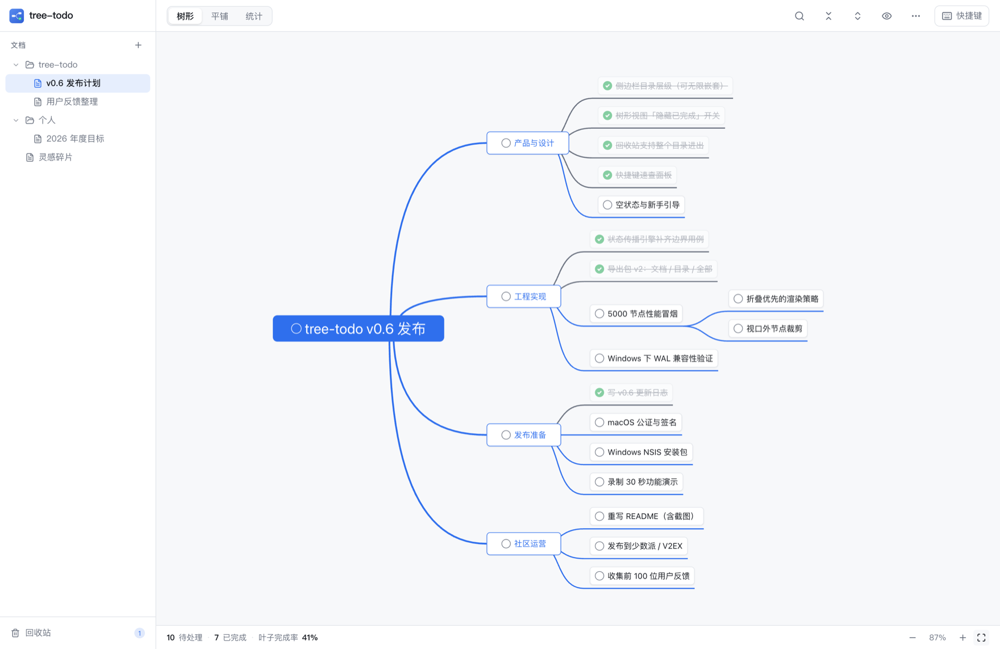

> The task tree in the screenshots is demo data.

---

## The problem

Your to-do list probably looks like this: 40 tasks flattened into a single list.
"Redesign the homepage" sits next to "Reply to the client's email" — you can't tell which goal each belongs to, or how much work a given thread still has left.

So you switch to a mind map: now the structure is clear, but nodes have no state.
Finish a subtask and you have to go back and tick off its parent too; add a new subtask and you forget to set the parent back to pending. **Structure tools and status tools are two different things.**

Tree Todo merges them into a single action:

> **Express structure as a tree; maintain progress by propagation.**

| What you use today | Where it breaks down |
| --- | --- |
| Flat to-do lists | Hierarchy is faked with indentation; past a few dozen items you can't see what belongs to what, or answer "how much is left on this thread?" |
| Mind-mapping tools | Great structure, but no pending / done on nodes — parent progress is synced by hand and inevitably drifts |
| Project-management SaaS | Heavy, online, account required; one person's tasks don't justify a whole system |

Tree Todo clears all of these hurdles. It's also built on the idea that **a to-do is a prompt**: any task on the tree can be handed straight to an AI Agent, and execution state is written back to Tree Todo through MCP callbacks — which node is running and which awaits your review are visible at a glance.

## Features

### 1. Tree view: nest as deep as you need

- Horizontal mind-map layout: root on the left, children growing rightward, so goals and subtasks are obvious at a glance
- Any node can be split further, with no depth limit; long text wraps instead of being truncated
- Trackpad two-finger pan / pinch zoom (10%–400%), `Shift+1` fits the whole tree
- Collapse badges tuck away a branch; `Ctrl+1` toggles to the flat view and back

### 2. Automatic status propagation: just tick the leaves

This is the heart of the product. There are only four rules:

| What you do | What happens |
| --- | --- |
| Tick off a parent task | The whole branch completes with it (cascading down) |
| All subtasks complete | The parent completes automatically, and it propagates all the way up |
| Add a subtask under a completed task | That task reverts to "Pending" |
| Uncheck any subtask | Every ancestor in its chain returns to "Pending" |

So you never have to decide "should the parent be ticked?" — the shape of the tree **is** the truth about progress.
Completed nodes get a strikethrough and reduced opacity, and the whole connecting line turns grey, so a finished branch stands out immediately.

> Under the hood, propagation happens only on the Rust side, in the same transaction as the write; the frontend holds nothing but a render snapshot.
> That's why rapid clicking and consecutive node creation can't leave state inconsistent, and you never get "ticked in the UI, not written to the database".

### 3. Flat view: only what's still left to do

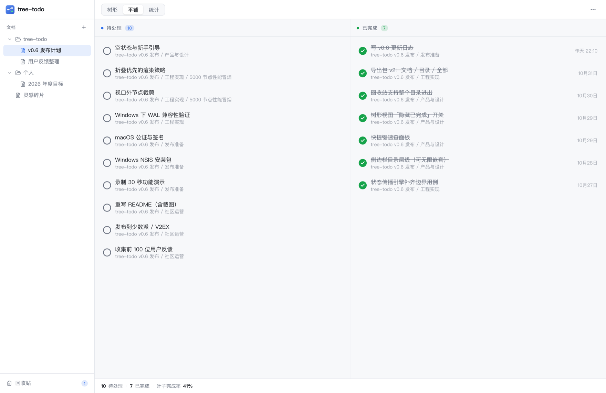

- Lists **leaf tasks only** (the atomic, directly actionable items); container nodes aren't repeated
- Pending items on the left follow the tree's depth-first order, so leaves of the same thread stay together; completed items on the right are sorted by completion time, newest first
- Every row carries a breadcrumb path (`Tree Todo v2.0 release / Release prep / macOS notarization & signing`); click one to jump back into the tree, locate and highlight the node
- Completed rows show "Today / Yesterday / Oct 31", and items awaiting review get their own counter

### 4. AI Agent collaboration: a to-do is a prompt — copy it to an Agent, keep the sign-off

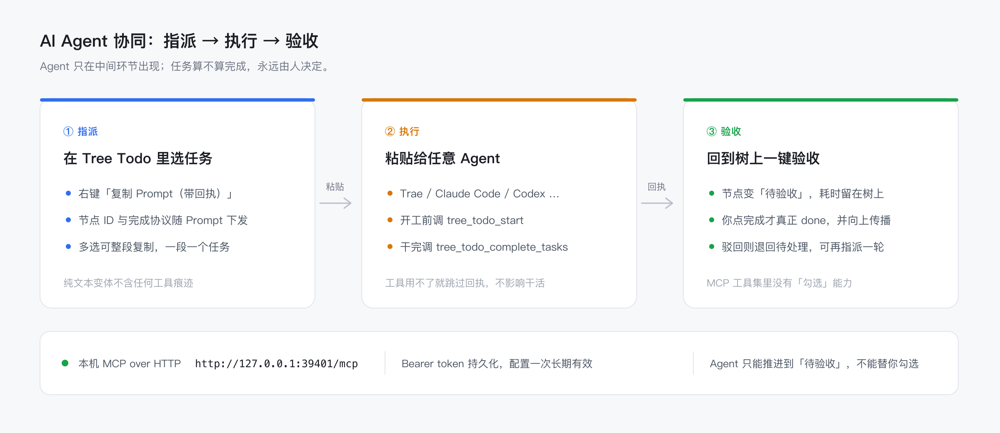

- Right-click → "Copy Prompt (with receipt)", paste it into Trae / Claude Code / Codex / any MCP-capable Agent
- Before starting, the Agent calls `tree_todo_start` and the node lights up as "Running · timer"; when done it calls `tree_todo_complete_tasks` and the node becomes "Awaiting review"
- **There is no "tick a task as done" tool in the MCP toolset** — an Agent can only push a task to "Awaiting review"; only you can mark it done
- Multi-select to copy a whole batch; re-copying the same nodes reuses the same run; dispatches not started within 24 hours expire automatically
- Local service (`127.0.0.1:39401`) + persistent token — configure once, it keeps working

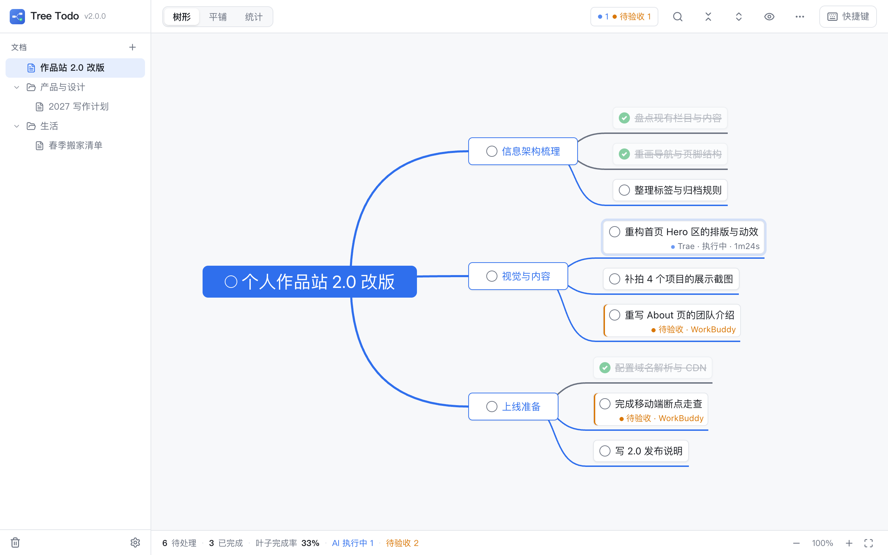

The "Running / Awaiting review" counters in the top bar are the entry point. Open them and you get the run drawer for that round: the Agent, total elapsed time, per-node receipts and the prompt snapshot — review happens here too.

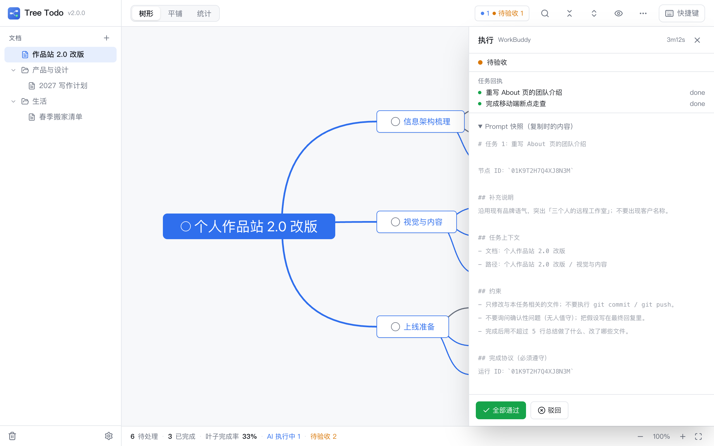

See [Working with AI Agents: 3-Step Setup](#working-with-ai-agents-3-step-setup) for the full setup.

> The task trees, Agent names and receipts in the screenshots are demo data.

### 5. Multiple documents + folders: keep threads separate

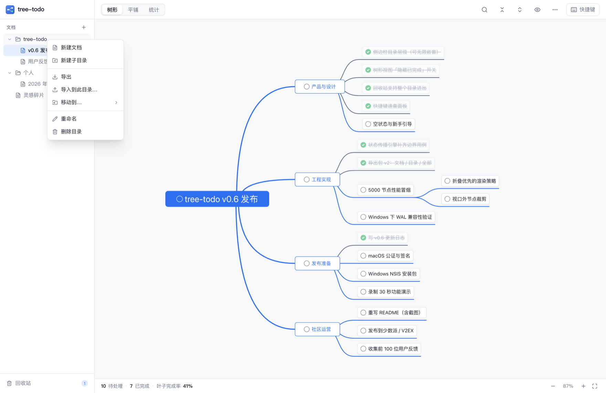

- Each document is an independent tree backed by its own SQLite file on disk
- Folders nest without limit; right-click to create a document / subfolder, export, move to, rename, or delete
- Drag to reorder siblings, drop into a folder, or drop onto empty space to move back to root level; hovering over a collapsed folder expands it first, and cycle prevention is double-checked in Rust
- Sidebar width is draggable; folder expansion state is remembered per folder

### 6. Keyboard-first: never touch the mouse

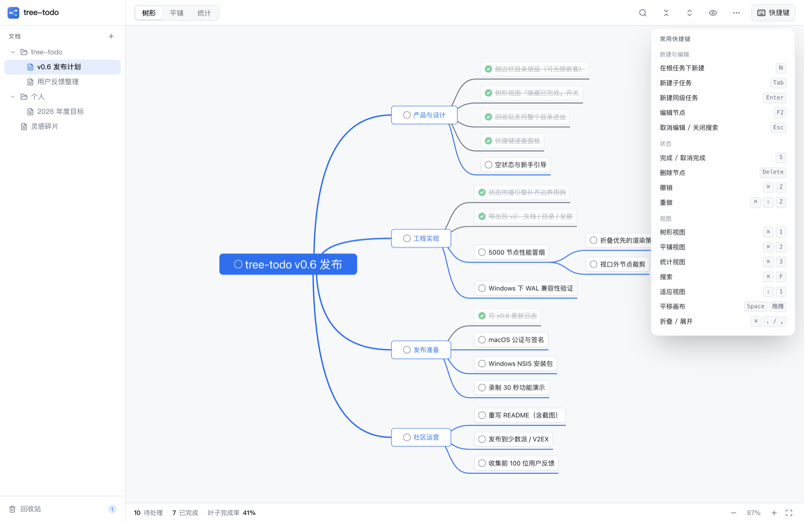

`N` new → type → `Tab` split a subtask → type → `Enter` add a sibling → `S` mark done.
A whole thread can be built in seconds without leaving the keyboard. `⌘F` search, `⌘Z` undo, `⌘1/2/3` switch views — all at your fingertips;
dispatching to an Agent is only `⌘⇧R` away.

### 7. Search and jump

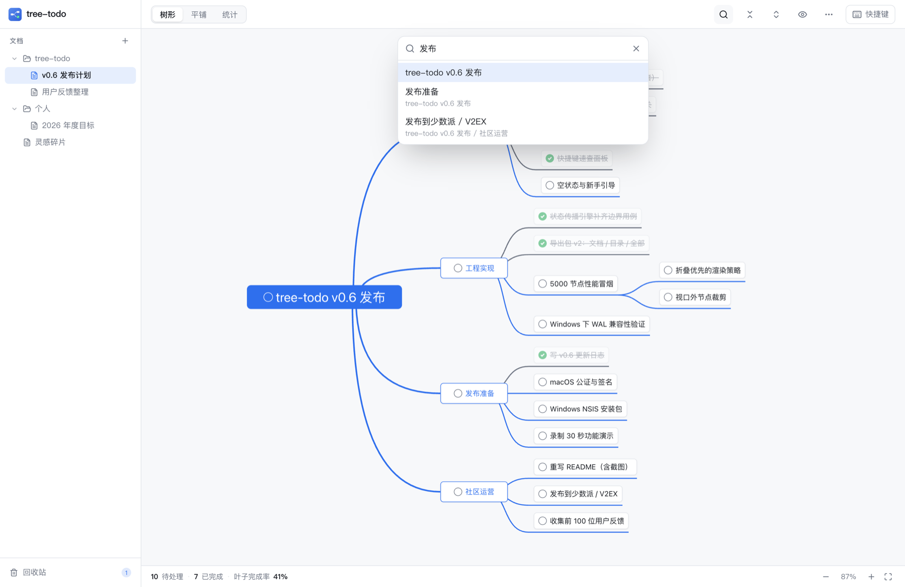

`⌘F` opens the search overlay, matching both task content and notes; `↑↓` to select, `Enter` to jump — ancestors expand automatically, the node scrolls into view and is highlighted.

### 8. Stats: how far along is this thread

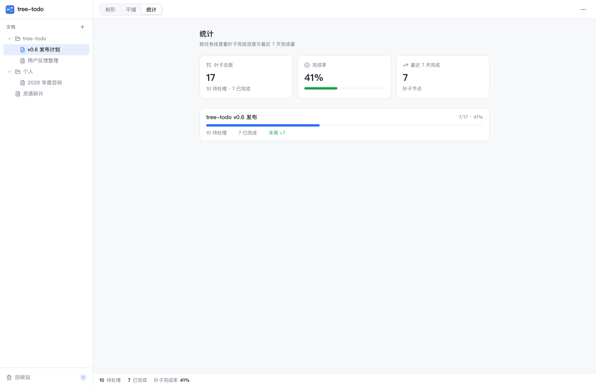

Per-thread totals of leaf tasks, pending / done, completion rate, and completions over the last 7 days. It measures real progress on **actionable items**, not a percentage diluted by container nodes.

### 9. Hide done: see only what you still owe

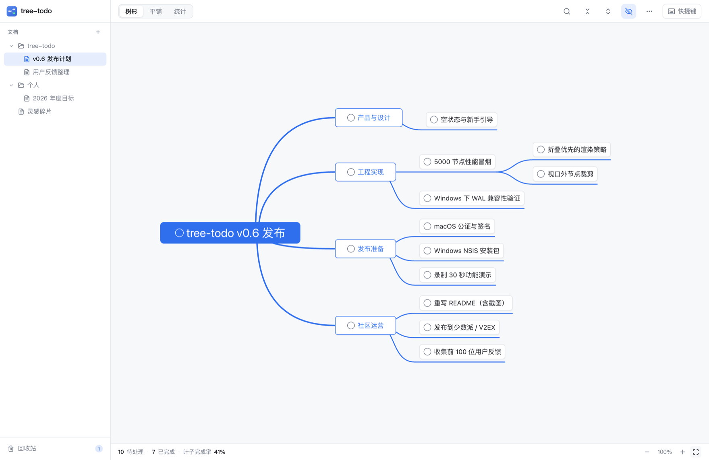

The little eye button in the top bar collapses all completed nodes and their subtrees in one click (the root task always stays), and the switch is **remembered per document**. With a large tree, it's the fastest way to focus.

### 10. Trash and undo: deleting is reversible

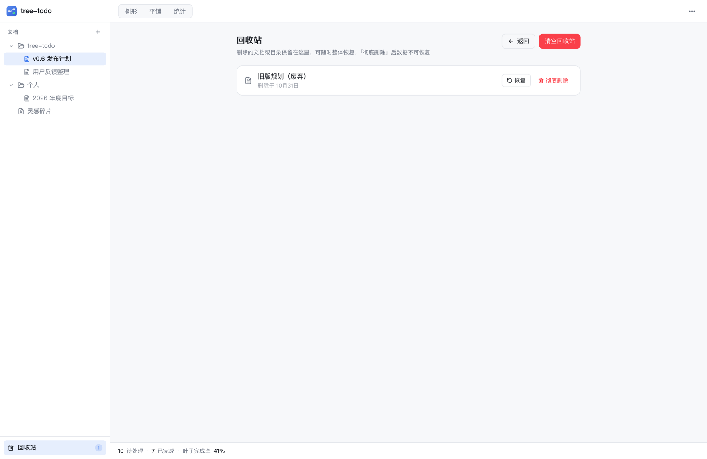

- Deleted documents / entire folders go to the Trash, where they can be restored, permanently deleted, or emptied; restoring a folder reinstates its structure and document associations exactly
- Trash can auto-clean by age (30 days by default, `0` = off), configurable in Settings; records awaiting review are never purged
- Node deletion is immediate and physical, but `⌘Z` brings it right back — every mutating action is recorded in history (100 steps)
- Drag to change parent/child relationships, `Alt+↑/↓` to reorder siblings; cycle prevention is double-checked in Rust

### 11. Light and dark themes

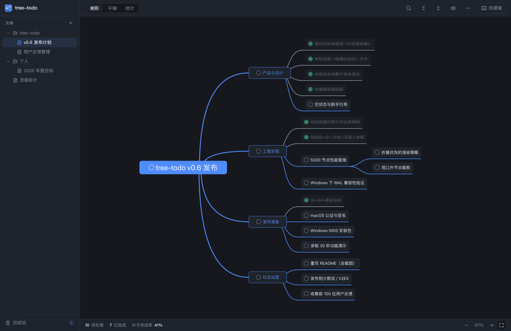

Follow system / Light / Dark — switch at any time.

### 12. Your data lives on your own disk

- One SQLite file per document, **written transactionally on every action** — there is no "Save" button, just close the app
- No account, no network, no telemetry; copy the data directory for a complete backup
- Export "current document / a folder / everything" into a single `.json` file; importing restores it wholesale (handy for switching machines or archiving)

### 13. Auto-update: new versions find you

- Checks GitHub Releases on startup; a dialog shows the version number and release notes when an update is available
- You can also click the version number in the top-left corner, or use the system menu "Check for Updates…"; if there's nothing new it says "You're up to date"
- Windows downloads, installs and restarts in-app; macOS opens the Releases download page (not yet signed / notarized)
- Updates only replace the binary — documents, folders, Trash and run records are untouched

### 14. Copy & paste nodes: take the whole subtree with you

Right-click a node → **Copy node (with subtree)**, then right-click the destination → **Paste as child node**; or just `⌘C` / `⌘V` (`Ctrl` on Windows). Copy a parent and every descendant, its notes and its ordering come along — paste them under any node, even in a **different document**.

- Select several nodes to copy them all at once; when an ancestor is already in the selection, its descendants are skipped so nothing is duplicated
- The clipboard lives in the Rust process and survives document switches, so copying from document A into document B just works; it is cleared when the app exits
- Pasted nodes keep their completion state: done subtrees stay done (including their completion timestamps), and the destination parent is recalculated from its children — it stays done if the pasted subtree is all done, and reopens only if pending items came along. Agent execution badges and run records are not copied; the whole paste is one `⌘Z` away from being undone
- Copying also puts an indented plain-text outline on the system clipboard, handy for pasting a plan into a chat or an email

## Working with AI Agents: 3-Step Setup

> Works with any MCP-capable Agent (Trae, Claude Code, Codex, Cursor…).
> No MCP? Still usable — right-click "Copy Prompt" for a plain-text variant; you just lose the "Running / Awaiting review" lights.

### 1. Configure MCP (once)

Settings (the gear at the bottom of the sidebar) → **MCP Integration** → pick your Agent → **Copy MCP config**, then paste it into the Agent's MCP settings:

```json
{
  "mcpServers": {
    "tree-todo": {
      "url": "http://127.0.0.1:39401/mcp",
      "headers": {
        "Authorization": "Bearer <the token shown in Settings>",
        "X-Tree-Todo-Agent": "Trae"
      }
    }
  }
}
```

- The service listens on loopback only; the token is persisted in `mcp.json` in the data directory, so the config survives restarts
- If the port is taken it increments by 1 and asks you to re-copy the config; "Reset token" immediately invalidates the old one
- `X-Tree-Todo-Agent` decides whose name shows on the node badge (Trae / Claude Code / Codex…)

### 2. Copy the prompt

Right-click a task in the tree → "Copy Prompt (with receipt)" (`⌘⇧R` / `Ctrl+Shift+R`).

With a multi-selection, right-click copies **the whole batch**: one `# Task N` section per node, all sharing a single runId; right-clicking inside the selection applies the action to the entire selection.
A parent's prompt lists only **pending** subtasks — done, running and awaiting-review children aren't dispatched twice.

Here's an abridged example of what the Agent receives (translated from the app's Chinese prompt):

```text
# Task: Refactor the export flow to support exporting by folder

Node ID: `01JBQ7K3...`

## Task context
- Document: Product requirements
- Path: Tree Todo v2.0 release / Release prep

## Subtasks (this task is complete only when all are done)
- [ ] Extract the packaging function
- [ ] Add unit tests
- [ ] Update docs/03

## Completion protocol (must follow)
Run ID: `01JBQ7K3...`

Nodes requiring a receipt in this run:
- `01JBQ7K3...` Refactor the export flow to support exporting by folder

1. **Before you start**, call the MCP tool `tree_todo_start`:
   `{"run_id":"01JBQ7K3...","agent_name":"<your product name, e.g. Claude Code / Trae>"}`
   — the task will be marked "Running" and the timer starts.
2. **When everything is done**, call the MCP tool `tree_todo_complete_tasks`:
   `{"run_id":"01JBQ7K3...","tasks":[{"id":"01JBQ7K3...","result":"done","summary":"one-line explanation"}]}`
   — the task moves to "Awaiting review"; whether it's actually done is up to the user.
3. If those tools aren't available (Tree Todo isn't running or its MCP server isn't configured), just finish the task — no receipt needed.
4. Never attempt to "complete / tick" a task on the user's behalf.
```

The "constraints" section of the prompt can be edited in Settings (one per line); the defaults are a few rules distilled from the pitfalls we hit on this path.

### 3. Paste it to the Agent, then review back on the tree

| Moment | Agent calls | Node changes |
| --- | --- | --- |
| Starting work | `tree_todo_start` | "Running · 1m20s", stopwatch starts |
| Everything done | `tree_todo_complete_tasks` | "Awaiting review · Trae", stopwatch stops |

An "Awaiting review N" badge appears in the top bar; opening the run drawer shows the Agent for this round, total elapsed time, the prompt snapshot, and each node's receipt and summary.

Back on the tree, two ways to review — both are fine:

- **Accept** → click "Accept all" in the drawer, or just tick the node in the tree (`S`). Both go through the same propagation transaction: when all subtasks are done, the parent completes and it propagates upward
- **Reject** → write a short reason (it's written back to the node's notes), the node returns to "Pending", then copy a fresh round after fixing it; the old receipt is voided and won't mix with the new round
- **Agent stalled** → a running timer never stops on its own; seeing "2h35m" means it's time to step in. The drawer has "Mark as ended" to close it out manually

| MCP tool | Called by | Effect |
| --- | --- | --- |
| `tree_todo_start` | Agent | Marks a node "Running" and starts the timer |
| `tree_todo_complete_tasks` | Agent | Marks a node "Awaiting review" / "Failed", stops the timer, attaches a one-line summary |

> **The sign-off is physically isolated**: no tool in the MCP toolset can write task state; an Agent can at most push a task to "Awaiting review".
> That's a hard boundary in code, not a gentleman's agreement in a prompt — see [`docs/06-agent-integration.md`](docs/06-agent-integration.md) for details.

### Why copy-paste instead of automatic dispatch

1.0 tried having the host spawn an Agent CLI subprocess and dispatch work directly. All three paths dead-ended: consumer Agent plans have no CLI; where a CLI exists, the working directory and model flags differ per vendor and drift between versions; and even the exit code lies (auth failures still return 0).

2.0 deleted that whole chain and kept only the two things that are actually stable: **a prompt you can paste, and a local MCP endpoint**.
Who executes, with which model, in which directory — that's your call on the Agent side. Tree Todo only owns "where tasks come from" and "who decides they're done".

## Use cases

| Scenario | How it fits |
| --- | --- |
| **Indie dev / solopreneur** | Product line → version → feature → concrete change; with several lines in parallel you can still see which one is blocked |
| **Delegating work to AI** | Break down to leaves → copy the prompt with receipt → paste to the Agent → review in one click back on the tree; progress and elapsed time stay on the tree |
| **Content creation** | Topic → outline → material → publish; one article is one small tree |
| **Studying for exams** | Subject → chapter → knowledge point; finishing a chapter collapses the progress above it automatically |
| **Life projects** | Moving house, a wedding, planning a long trip — many items, dependencies, and a constant need to know what's left |
| **Goal breakdown** | Annual goal → quarterly KR → this week's actions, with the stats panel to watch the pace |

## How it compares

| | Structure | Task state | Offline / local | Learning curve |
| --- | :---: | :---: | :---: | --- |
| Flat to-do apps | Weak (indentation) | Strong | Mostly needs an account | Low |
| Mind-mapping tools | Strong | Weak (no pending / done) | Depends | Medium |
| Project-management SaaS | Medium | Strong | No | High |
| **Tree Todo** | **Strong** | **Strong (auto-propagated)** | **Yes (local SQLite)** | **Low** |

There's one more difference when it comes to AI: other tools let an Agent change task state directly; Tree Todo only lets it report back to "Awaiting review".
**Execution can be outsourced. Sign-off can't.**

## Getting started

### Download

Grab the installer for your platform from [Releases](https://github.com/Jeysin/tree-todo/releases):

| Platform | File |
| --- | --- |
| macOS (Universal, Apple Silicon + Intel) | `Tree Todo_2.0.0_universal.dmg` |
| Windows (x64) | `Tree Todo_2.0.0_x64-setup.exe` |

> The installers are not yet code-signed or notarized: on macOS, right-click → "Open" the first time, or allow it in "System Settings → Privacy & Security";
> on Windows, if SmartScreen warns, click "More info → Run anyway".
>
> Once installed you never need to hunt for new versions: the app checks on startup, and you can also click the version number in the top-left or use the menu "Check for Updates…".
> Windows supports in-app download, install and restart; macOS currently opens the Releases download page.
>
> Users on 1.0.0 need to install 2.0.0 manually once (the old version has no updater); auto-upgrade starts from 2.0.0.

### Build from source

#### Requirements

| Tool | Version | Notes |
| --- | --- | --- |
| Node.js | ≥ 22 | Frontend build |
| pnpm | ≥ 9 | Package manager |
| Rust | stable (edition 2024 support, ≥ 1.85) | Backend and bundling |
| macOS | Xcode Command Line Tools | `xcode-select --install` |
| Windows | MSVC Build Tools + WebView2 Runtime | Win11 ships WebView2; Win10 needs a separate install |

#### Build and run

```bash
git clone https://github.com/Jeysin/tree-todo.git
cd tree-todo

pnpm install        # install frontend dependencies
pnpm tauri dev      # dev mode (frontend hot reload)

pnpm tauri build    # build an installer for the current platform
```

> Bundling enables updater artifact signing (`createUpdaterArtifacts`), so a local `pnpm tauri build`
> needs `TAURI_SIGNING_PRIVATE_KEY` (see `docs/08-auto-update.md` §4.4);
> to build without bundling, use `pnpm tauri build --no-bundle`.

Artifacts land in `src-tauri/target/release/bundle/`:

- **macOS**: `macos/Tree Todo.app`, `dmg/Tree Todo_<version>_<arch>.dmg`
- **Windows**: `nsis/Tree Todo_<version>_x64-setup.exe`

The first build takes 3–10 minutes (all Rust dependencies from scratch); incremental builds afterwards take seconds.

### Where data is stored

| Platform | Path |
| --- | --- |
| macOS | `~/Library/Application Support/com.jeysin.treetodo/` |
| Windows | `%APPDATA%\com.jeysin.treetodo\` |

Inside: `documents.json` is the document index, `docs/<id>.db` holds each document's data, `trash/` is the Trash,
`mcp.json` stores the MCP service's port and token, and `global.db` holds the rebuildable aggregate behind the
calendar heatmap.

## Keyboard shortcuts

Use `⌘` on macOS and `Ctrl` on Windows.

| Action | Key | Action | Key |
| --- | --- | --- | --- |
| New task under root | `N` | New subtask | `Tab` |
| New sibling task | `Enter` | Edit node | `F2` / double-click |
| Complete / uncomplete | `S` | Delete node | `Delete` |
| Undo / redo | `⌘Z` / `⇧⌘Z` | Search | `⌘F` |
| Tree / Flat / Stats / Overview | `⌘1` / `⌘2` / `⌘3` / `⌘4` | Fit to view | `⇧1` |
| Collapse / expand node | `⌘.` | Move sibling up / down | `Alt+↑` / `Alt+↓` |
| Copy Prompt | `⌘⇧C` | Copy Prompt (with receipt) | `⌘⇧R` |
| Copy node (with subtree) | `⌘C` | Paste as child node | `⌘V` |
| Node details | `Alt+Enter` | Pan the canvas | `Space` + drag |

## Tech stack

| Layer | Choice |
| --- | --- |
| Desktop framework | Tauri 2 (the macOS app bundle is only ~6 MB, with far lower memory use than Electron) |
| Frontend | React 19 + TypeScript (strict) + Vite + Tailwind CSS 4 + Zustand 5 |
| Tree rendering | Mind Elixir 5 (layout / zoom / drag / collapse / keyboard navigation) |
| Backend | Rust (edition 2024) + rusqlite (bundled SQLite) |
| Core logic | `src-tauri/src/propagate.rs` — a pure propagation engine, unit-tested across every rule and edge case |
| Agent collaboration | Local HTTP MCP server (`runtime/`) + prompt assembly (`agents/`), receipts written in the same transaction as node changes |

```
src/                  React frontend
  components/         Sidebar, top bar, status bar, run drawer, toasts
  views/tree/         Tree (mind-map) view
  views/flat/         Flat view
  views/stats/        Stats view
  views/overview/     Overview (calendar heatmap)
  views/trash/        Trash
  stores/             Zustand (render snapshots only)
  ipc/                The single TS gateway for Tauri commands
src-tauri/src/
  commands/           IPC commands (validation + delegation)
  db/                 SQLite access and migrations
  propagate.rs        Status propagation engine
  history.rs          Undo / redo (snapshot-based replay)
  storage.rs          Multiple documents, folders and Trash
  agents/             Prompt assembly + MCP toolset
  runtime/            Local MCP service (fixed port + persistent token)
docs/                 Requirements / data model / interaction / UI / roadmap / Agent integration
```

One deliberate design choice: **domain rules are implemented exactly once, in Rust — the frontend derives no state at all**.
Every mutating command runs "write + cascade + upward propagation" in a single transaction and returns the affected subtree snapshot for the frontend to merge.
The rule table and 8 edge cases live in [`docs/02-data-model.md`](docs/02-data-model.md);
the Agent's two-phase receipt and the sign-off boundary are in [`docs/06-agent-integration.md`](docs/06-agent-integration.md).

## Contributing

- Found a bug or have an idea? Open an [Issue](../../issues) with reproduction steps or a screenshot
- Before a PR, please read [`AGENTS.md`](AGENTS.md) (code conventions) and [`docs/02-data-model.md`](docs/02-data-model.md) (domain-rule red lines). The design docs are written in Chinese.
- Make sure these pass locally before submitting:

```bash
cargo test                                   # propagation engine unit tests must all pass
cargo clippy --all-targets -- -D warnings    # zero warnings
pnpm build                                   # type check + frontend build
```

## License

[MIT](LICENSE) © 2026 jeysin

<p align="center">
  <a href="./README.md">English</a> &nbsp;|&nbsp; <a href="./README.zh-CN.md">简体中文</a>
</p>
