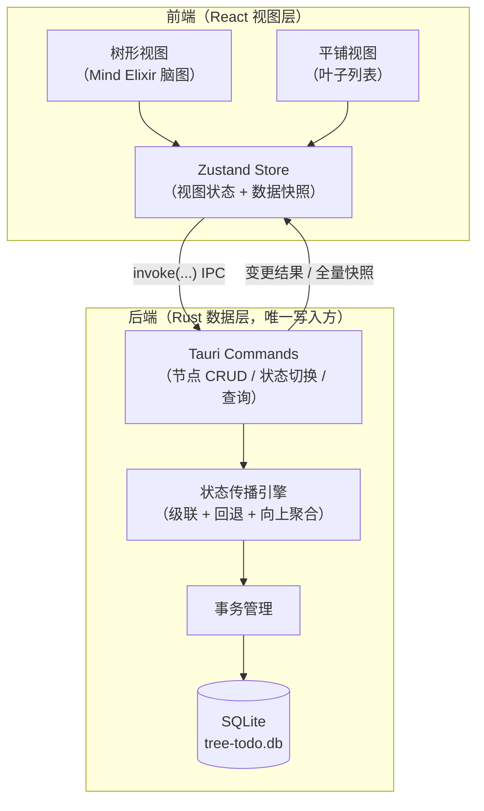

# 01 · 技术方案总览

> tree-todo 是一个跨平台树形待办桌面应用：待办事项像脑图一样无限分叉，每个节点带「待处理 / 已完成」状态，并沿树自动传播。

## 1. 项目定位

**一句话**：把「脑图的无限层级」和「待办的状态追踪」合二为一。

传统待办软件（Todoist、滴答清单等）以平铺列表为主，只能线性罗列事项。但在 AI Agent 全面爆发的时代，独立开发者、一人公司、超级个体往往同时推进多个任务，每个任务下又层层拆出子任务——「一个目标 → 多个任务 → 多个子任务」天然是一棵树。平铺列表无法表达这种层级推进关系，用户需要一个**全局视角**：在一张图上看到每条任务线的拆解结构和完成进度。

tree-todo 的回答就是「树形待办」：

- 任意节点可以无限创建子节点（脑图能力）；
- 每个节点创建即为「待处理」，可被置为「已完成」；
- 子节点全部完成时，父节点自动变为已完成；在已完成节点下新增子节点时，父节点自动回退为待处理（待办能力）；
- 除树形（脑图）视角外，可切换平铺视角，集中查看所有待处理 / 已完成的叶子节点。

## 2. 目标用户与核心场景

| 用户画像 | 典型场景 |
|---|---|
| 独立开发者 / 一人公司 | 同时开发多个产品，每个产品拆出功能 → bug → 发版清单 |
| 超级个体（自媒体、独立顾问） | 多线运营：内容排期、客户项目、个人成长并行 |
| 企业内身兼多职者 | 同时承接多个部门的需求，需要向上汇报各条线的进度 |

共性痛点：**任务树越来越深、越来越多，平铺清单看不到结构，也看不到「哪条线还堵着」**。

## 3. 技术选型

### 3.1 桌面框架对比

| 维度 | Tauri 2 | Electron | Flutter Desktop |
|---|---|---|---|
| 安装包体积 | ⭐⭐⭐⭐⭐（约 5–10 MB） | ⭐⭐（80–150 MB） | ⭐⭐⭐（30–60 MB） |
| 运行内存占用 | ⭐⭐⭐⭐⭐（低） | ⭐⭐（高） | ⭐⭐⭐⭐（中） |
| 脑图 / 图形 UI 生态 | React 全生态可复用 | React 全生态可复用 | Dart 生态弱 |
| 桌面成熟度（2026） | 高（2.x 稳定多年） | 最高 | 中 |
| 后端语言 | Rust（安全、高性能） | Node.js | Dart |
| 平台支持 | Windows / macOS / Linux | Windows / macOS / Linux | 三方包质量参差 |

**决策：Tauri 2 + React + TypeScript**

理由：

1. **资源占用是效率工具的命门**。目标用户是重度效率工具用户，对「一个待办软件吃掉几百 MB 内存、安装包上百 MB」零容忍。Tauri 用系统 WebView + Rust 后端，体积与内存占用比 Electron 低一个数量级。
2. **脑图渲染的全部生态在 Web 端**（Mind Elixir 等），Tauri 前端层可 100% 复用 Web 生态，渲染与交互能力不受限。
3. **Rust 数据层保证状态一致性**。状态自动传播（级联 / 回退）是本项目最核心的领域逻辑，放在 Rust 层可以用类型系统 + 事务保证正确性，且万级节点下性能无忧。
4. Tauri 2 的 Windows / macOS 支持已充分成熟，无平台风险。

> 若后续发现 Tauri 生态短板（如特殊系统 API），Tauri 也支持 Node.js sidecar 逃生舱；前端代码理论上可低成本迁移到 Electron，技术风险可控。

### 3.2 前端栈

| 依赖 | 用途 | 说明 |
|---|---|---|
| React 19 + TypeScript 5（strict） | UI 框架 | 脑图交互组件生态最丰富 |
| Vite | 构建器 | Tauri 官方推荐模板 |
| Zustand 5 | 视图状态管理 | 轻量，适合中型应用 |
| mind-elixir 5（本地 fork/补丁） | 脑图交互底座 | 布局、展开/收起、拖拽、折叠角标、平移缩放、键盘导航、内联编辑 |
| Tailwind CSS 4 | 样式 | 双主题（明 / 暗）成本低 |
| lucide-react | 图标 | 轻量、风格统一 |

### 3.3 后端栈（Rust，src-tauri/）

| 依赖 | 用途 |
|---|---|
| tauri 2 | 应用框架 |
| rusqlite（bundled SQLite） | 嵌入式数据库，单文件存储 |
| serde / serde_json | 序列化（IPC 与导入导出） |
| uuid | 节点 ID 生成 |
| tauri-plugin-updater / tauri-plugin-process | 自动更新：检查、下载、Ed25519 验签、安装与重启（`08-auto-update.md`） |

### 3.4 数据存储

- **本地 SQLite 单文件**（`app_data_dir/tree-todo.db`），随用随存、零配置、易备份（复制文件即可）。
- v0.1 无云同步；多设备同步是 v1.x+ 的远期课题（见 `05-roadmap.md`）。
- 不采用 JSON 文件存储：树可无限增长，JSON 全量读写无法支撑增量操作与万级节点性能。

## 4. 总体架构



### 职责边界（铁律）

1. **所有数据变更必须经 Rust 数据层**（Tauri command）。前端不直连数据库、不读写本地文件、不自行持久化。
2. **状态传播只在 Rust 层实现**（级联、回退、向上聚合），前端不得在任何路径上自行计算节点状态——保证任意入口进来的一致性。
3. **前端只持有「渲染快照」**：每次变更后以 Rust 返回的最新数据为准刷新，不维护第二份真相。

### 为什么状态传播放 Rust 而不是前端？

- 一致性：传播规则是领域不变量（见 `02-data-model.md` §2），放数据层可在事务内完成「写入 + 传播」原子提交，杜绝中间态。
- 性能：万级节点树的向上聚合在 SQL + 索引内完成，避免把整棵树拉到前端递归。
- 可测试：领域规则以纯函数 + 单元测试锁定，不受 UI 重构影响。

## 5. 项目目录结构（规划）

```
tree-todo/
├── src/                      # React 前端
│   ├── components/           # 通用组件（Checkbox、Toolbar…）
│   ├── views/
│   │   ├── tree/             # 树形（脑图）视图：画布、节点、连线、视口控制
│   │   └── flat/             # 平铺视图：叶子分组列表
│   ├── stores/               # Zustand：数据快照、选中/折叠、视图模式
│   ├── ipc/                  # Tauri command 的 TS 封装（唯一 IPC 出口）
│   ├── lib/                  # 前端纯函数（布局换算等）
│   └── styles/               # Tailwind 与主题变量
├── src-tauri/                # Rust 后端
│   ├── src/
│   │   ├── main.rs / lib.rs  # Tauri 入口、command 注册
│   │   ├── commands/         # IPC 命令（薄层，校验 + 委托）
│   │   ├── model.rs          # Node 等核心数据结构
│   │   ├── db/               # SQLite 访问、迁移
│   │   ├── propagate.rs      # 状态传播引擎（领域核心）
│   │   └── error.rs          # 统一错误类型
│   └── tauri.conf.json
├── docs/                     # 技术文档（本目录）
├── AGENTS.md
├── CHANGELOG.md
└── README.md
```

## 6. 关键决策索引（ADR 摘要）

| # | 决策点 | 结论 | 详见 |
|---|---|---|---|
| D1 | 桌面框架 | Tauri 2（非 Electron） | 本文 §3.1 |
| D2 | 状态传播模型 | 聚合派生 + 级联开关：非叶子的状态由子节点聚合得出，手动完成/取消对任何节点都生效并级联子孙 | `02-data-model.md` §2 |
| D3 | 根节点形态 | 单根（每个文档一个根任务；多任务线由多文档承载） | `02-data-model.md` §3 |
| D4 | 树渲染方案 | Mind Elixir（本地 fork/补丁）：脑图交互全部由其提供，前端只叠加待办状态 | `03-feature-design.md` §2 |
| D5 | 存储 | SQLite 单文件 + 分数定位排序 | `02-data-model.md` §1 |
| D6 | IPC 数据流 | 每次操作返回「受影响子树快照」，前端全量受控刷新 | `03-feature-design.md` §6 |
| D7 | 自动更新 | 官方 updater 插件 + GitHub Releases 静态清单 `latest.json`（Ed25519 验签）；macOS 未签名期降级为打开下载页 | `08-auto-update.md` |

## 7. 非目标（当前版本明确不做）

- ❌ 多人协作 / 权限（单人工具）
- ❌ 云同步（远期调研 iCloud / WebDAV，见路线图）
- ❌ 日历 / 提醒 / 番茄钟（专注树形待办本身，避免功能蔓延）
- ❌ 甘特图、时间线视图（与「进度追踪」定位不同）
