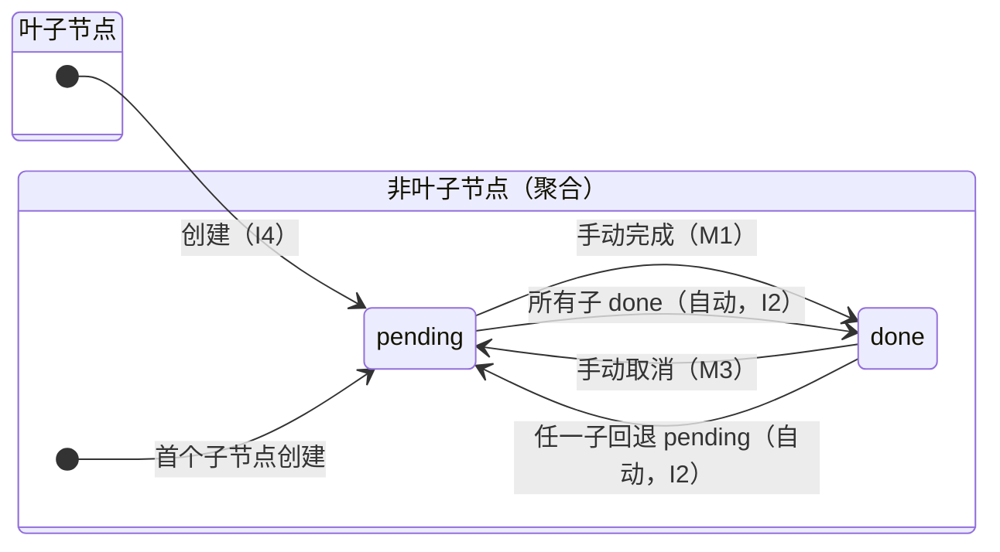

# 02 · 数据模型与状态传播

> 本文档定义 tree-todo 的核心领域模型：节点结构、存储 Schema、以及**状态自动传播规则**（本项目最核心的领域逻辑，任何实现不得偏离）。

## 1. 节点模型与存储

### 1.1 概念

- **文档（Document）**：所有待办树的容器。v0.1 只有一个默认文档；多文档支持是 v0.3+ 能力（见 `05-roadmap.md`）。
- **根节点（Root）**：`parent_id = NULL` 的节点。**单根模型**：每个文档只有一个根任务（默认内容「任务线」），所有任务都挂在它下面；根任务可编辑、可完成，但不可删除、不可拖拽。
- **叶子节点（Leaf）**：没有任何子节点的节点。平铺视图只展示叶子节点。

### 1.2 SQLite Schema

```sql
CREATE TABLE schema_version (
    version INTEGER NOT NULL
);

CREATE TABLE nodes (
    id         TEXT PRIMARY KEY,                -- UUID v4
    parent_id  TEXT,                           -- NULL = 根节点
    content    TEXT NOT NULL DEFAULT '',       -- 节点标题
    note       TEXT NOT NULL DEFAULT '',        -- 备注（v0.2 启用，字段先建好）
    status     TEXT NOT NULL DEFAULT 'pending', -- 'pending' | 'done'
    position   REAL NOT NULL,                  -- 同级排序（分数定位法）
    collapsed  INTEGER NOT NULL DEFAULT 0,     -- 折叠状态（0/1，UI 持久化）
    created_at TEXT NOT NULL,                  -- ISO 8601 UTC
    updated_at TEXT NOT NULL,                  -- ISO 8601 UTC
    FOREIGN KEY (parent_id) REFERENCES nodes(id) ON DELETE CASCADE
);

CREATE INDEX idx_nodes_parent ON nodes(parent_id);
```

**v2 迁移（v0.3 统计与旧版节点回收站字段）**：

```sql
ALTER TABLE nodes ADD COLUMN deleted_at TEXT;   -- 旧版节点软删除字段（v0.4 起不再写入，保留兼容）
ALTER TABLE nodes ADD COLUMN completed_at TEXT; -- 完成时间（随 status 自动维护，统计用）
CREATE INDEX idx_nodes_deleted ON nodes(deleted_at);
```

**v3 迁移（v0.4 单根 + 文档回收站）**：

```text
- 删除旧版节点回收站数据（deleted_at IS NOT NULL）；
- 多根文档：新建一个「任务线」根，把原有根按 position 顺序挂到新根下；
- 单根文档保持不变；空文档在文件库打开时自动补一个「任务线」根；
- schema_version → 3。
```

> **查询铁律**：所有「视图查询」必须过滤 `deleted_at IS NULL`。v0.4 起节点删除是物理删除，该字段恒为 NULL；回收站只包含被删除的**文档**。
> `completed_at` 由 `update_status` 与级联 SQL 统一维护（done → now，pending → NULL），不得手工赋值。

### 1.3 字段设计说明

| 字段 | 设计要点 |
|---|---|
| `id` | UUID v4，全局唯一，天然支持未来的复制 / 导入合并场景 |
| `parent_id` | `NULL` 表示根。`ON DELETE CASCADE` 保证删除节点时子孙随删 |
| `status` | 物化存储（虽然非叶子状态可由子节点聚合得出），换取平铺视图 / 统计的查询效率；一致性由传播引擎维护（§2.5） |
| `position` | **分数定位法**（fractional indexing）：同级插入中间取 `(prev + next) / 2`，头部插入取 `min - 1`，尾部插入取 `max + 1`，避免每次插入全量重排；REAL 精度约可支撑连续居中插入 ~50 次，耗尽时对该局部同级做一次性重排（维护任务，见 §4） |
| `collapsed` | 折叠是视图状态，但持久化到 DB——用户刷新 / 重启后应保持上次的折叠现场 |

### 1.4 不变量（Invariants）

任何时刻、任何操作完成后，数据库必须满足：

- **I1 树形性**：`parent_id` 构成有向无环树（无环、深度无硬限制）。
- **I2 状态聚合**：非叶子节点 `status = done` ⟺ 其**所有**子节点 `status = done`。
- **I3 叶子自由**：叶子节点状态由用户显式操作决定，不受其他叶子影响。
- **I4 默认待处理**：任何新建节点 `status = 'pending'`。

> 由 I2 推论：`done` 节点要么是叶子，要么整棵子树全 `done`；`pending` 节点至少存在一个 `pending` 的后代叶子。

## 2. 状态传播规则（核心领域逻辑）

### 2.1 规则表

节点状态只有两值：`pending`（待处理）/ `done`（已完成）。

| 编号 | 操作 | 操作节点自身 | 级联（子孙） | 向上传播 |
|---|---|---|---|---|
| C1 | 创建节点 | 新节点 = `pending` | — | ✅（祖先可能因此回退） |
| M1 | 手动完成（叶子） | → `done` | — | ✅ |
| M2 | 手动完成（非叶子） | → `done` | **所有 `pending` 子孙 → `done`**（递归） | ✅ |
| M3 | 手动取消完成 | → `pending` | **所有 `done` 子孙 → `pending`**（递归） | ✅ |
| D1 | 删除节点 | **物理删除整棵子树**（根任务不可删除） | 子孙级联物理删除 | ✅（父级重算） |
| E1 | 编辑内容 / 备注 | 状态不变 | — | ❌ |
| MV1 | 移动节点（v0.2） | 状态不变 | — | ✅ 旧路径与新路径分别传播 |

**语义解读**（写进产品帮助文档的话术）：

- 「完成」一个父节点 = 用户宣告「这件事整体结束了」→ 其下所有未完成子任务一并收尾（M2）。
- 「取消完成」一个父节点 = 「这件事还没完」→ 整棵子树重新打开（M3）。
- 状态切换对**任何节点**都可用，不存在「父节点不能点」的别扭交互；父节点的展示状态永远忠实反映子节点聚合结果。

### 2.2 向上传播算法

任何改变「子节点集合状态」的操作（C1 / M1 / M2 / M3 / D1 / MV1）完成后，从操作节点的父节点开始沿父链向上重算聚合：

```text
fn propagate_upward(start: NodeId):
    cur = parent_of(start)
    while cur is Some:
        children = fetch_children(cur)            -- 含 status
        new = if children.all(done) then done else pending
        if cur.status == new: break               -- 剪枝：已收敛，上层必然不变
        cur.status = new; save(cur)
        cur = parent_of(cur)
```

关键点：

- **剪枝**：一旦某祖先聚合结果与现值相同即可停止——其上必然也已一致（单次传播只影响一条祖先链）。
- **复杂度**：O(受影响祖先数 × 同级查询)，有 `idx_nodes_parent` 索引，万级节点无压力。
- **事务**：操作（自身 + 级联）与向上传播必须在**同一个 SQLite 事务**内提交，保证外部永远观察不到中间态。

### 2.3 Corner Cases（实现与测试必须覆盖）

| # | 场景 | 正确行为 | 依据 |
|---|---|---|---|
| CC1 | 在 `done` 节点下新建子节点 | 新节点 `pending` → 父回退 `pending`，祖父链继续向上重算 | 需求原文（规则 C1 + 传播） |
| CC2 | 完成父节点下最后一个 `pending` 子节点 | 父自动 `done`，并继续向上 | 需求原文（M1 + 传播） |
| CC3 | 取消已完成父节点（子全 `done`） | 整棵子树回退 `pending`（M3 级联），祖先链相应重算 | M3 |
| CC4 | 删除某节点后其父变成叶子（无子节点了） | 父的 `status` **保持不变**（不参与聚合，也无向上传播需求之外的改动） | I2 仅约束非叶子；叶子状态自由 |
| CC5 | 删除 `done` 父节点下唯一的 `pending` 子节点 | 父自动 `done` | D1 + 传播 |
| CC6 | 根任务的状态传播 | 根任务没有父节点，传播止步于根；根任务自身完成/取消仍按 M2/M3 级联整棵树 | 传播边界 |
| CC7 | 完成 A 节点，其兄弟 B 仍 `pending` | 父保持 `pending` | I2 |
| CC8 | 移动节点（v0.2）把自己移到自己的子孙下 | 拒绝，返回 `CyclicMove` 错误 | I1 |

> CC4 说明：用户已接受「在 done 节点下加子节点会丢失完成态」（需求原文明确），因此「删光子节点后父保持原状态」与之对称，规则可预测。若后续用户反馈不符合直觉，可在 v0.2 调整为「删除后若父变叶子且原为聚合 done 则回退 pending」——此调整不破坏 I2，仅改 CC4 一条。

### 2.4 状态机视图



### 2.5 Rust 侧实现约束

- 传播引擎位于 `src-tauri/src/propagate.rs`，**纯领域模块**：不依赖 Tauri 类型，可独立单测。
- 每个 command 对应一个「操作 + 传播」的原子事务；command 层只做参数校验与委托。
- 单元测试至少覆盖：规则表全部行 + CC1–CC8 + 5000 节点深 20 层树的传播性能测试。

## 3. 根节点形态决策（D3）

**采用单根**：

1. 脑图渲染底座（Mind Elixir）天然是单根模型，单根可以完全复用其展开/收起、拖拽、折叠角标与键盘交互；
2. 根节点就是一条「任务线」的任务节点：可编辑内容、可完成（完成根 = 完成整棵树）、不可删除、不可拖拽；
3. 多个独立任务线通过**多文档**承载（每个文档一个根任务），不再在同一个画布内放多个根。

> 迁移：旧版多根文档会在 schema v3 中自动生成一个「任务线」根，把原有根挂到其下，不丢数据。

## 4. 数据维护任务（工程化）

| 任务 | 触发时机 | 说明 |
|---|---|---|
| Schema 迁移 | 启动时 | 读 `schema_version`，逐版本执行迁移脚本（v0.1 → 1，预留迁移框架） |
| position 重排 | 写操作后惰性触发 | 同级 `position` 差值小于阈值（如 1e-6）时，对该组一次性重排（步长 1024） |
| 数据库备份 | 每日启动 + 关闭时 | 复制 db 文件为 `tree-todo.db.bak`（保留最近 3 份），v0.1 先实现为启动时单份备份 |

## 5. 导入 / 导出（v0.2，格式先行约定）

导出为人类可读的 JSON（同时是备份格式）：

```json
{
  "format": "tree-todo.export",
  "version": 1,
  "exported_at": "2026-11-01T12:00:00Z",
  "nodes": [
    { "id": "…", "parent_id": null, "content": "产品 A", "status": "pending",
      "position": 1024.0, "collapsed": false,
      "created_at": "…", "updated_at": "…", "children": [ /* 嵌套或由 parent_id 表达，采用 parent_id 扁平表达 */ ] }
  ]
}
```

导入时**不信任**文件中的 status 一致性：导入后强制跑一次全树传播校正，违反 I2 的数据以子节点聚合结果为准。
