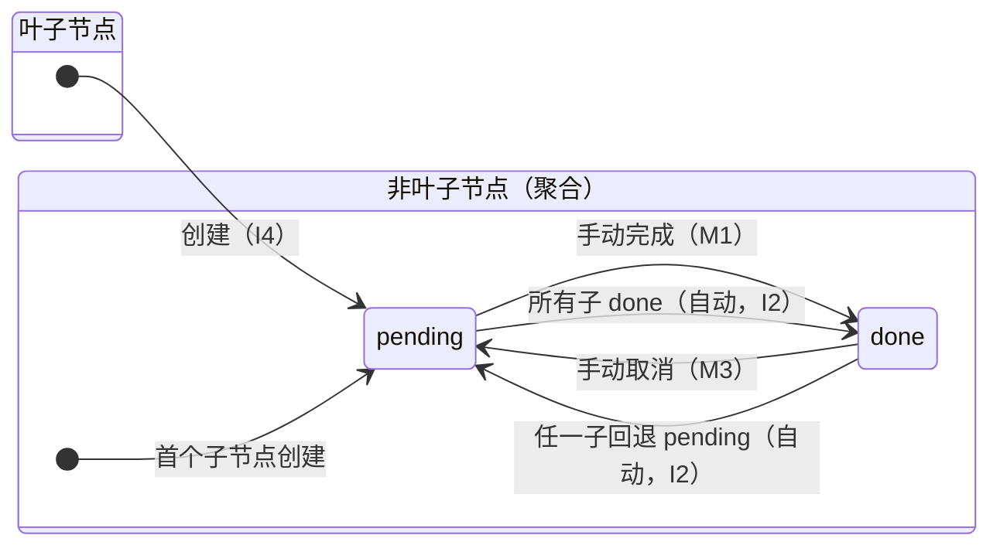

# 02 · 数据模型与状态传播

> 本文档定义 tree-todo 的核心领域模型：节点结构、存储 Schema、以及**状态自动传播规则**（本项目最核心的领域逻辑，任何实现不得偏离）。

## 1. 节点模型与存储

### 1.1 概念

- **文档（Document）**：所有待办树的容器。v0.1 只有一个默认文档；多文档支持是 v0.3+ 能力（见 `05-roadmap.md`）。
- **根节点（Root）**：`parent_id = NULL` 的节点。**单根模型**：每个文档只有一个根任务（默认内容「任务线」），所有任务都挂在它下面；根任务可编辑、可完成，但不可删除、不可拖拽。
- **叶子节点（Leaf）**：没有任何子节点的节点。平铺视图只展示叶子节点。

### 1.2 SQLite Schema

```sql
CREATE TABLE schema_version (
    version INTEGER NOT NULL
);

CREATE TABLE nodes (
    id         TEXT PRIMARY KEY,                -- UUID v4
    parent_id  TEXT,                           -- NULL = 根节点
    content    TEXT NOT NULL DEFAULT '',       -- 节点标题
    note       TEXT NOT NULL DEFAULT '',        -- 备注（v0.2 启用，字段先建好）
    status     TEXT NOT NULL DEFAULT 'pending', -- 'pending' | 'done'
    position   REAL NOT NULL,                  -- 同级排序（分数定位法）
    collapsed  INTEGER NOT NULL DEFAULT 0,     -- 折叠状态（0/1，UI 持久化）
    created_at TEXT NOT NULL,                  -- ISO 8601 UTC
    updated_at TEXT NOT NULL,                  -- ISO 8601 UTC
    FOREIGN KEY (parent_id) REFERENCES nodes(id) ON DELETE CASCADE
);

CREATE INDEX idx_nodes_parent ON nodes(parent_id);
```

**v2 迁移（v0.3 统计与旧版节点回收站字段）**：

```sql
ALTER TABLE nodes ADD COLUMN deleted_at TEXT;   -- 旧版节点软删除字段（v0.4 起不再写入，保留兼容）
ALTER TABLE nodes ADD COLUMN completed_at TEXT; -- 完成时间（随 status 自动维护，统计用）
CREATE INDEX idx_nodes_deleted ON nodes(deleted_at);
```

**v3 迁移（v0.4 单根 + 文档回收站）**：

```text
- 删除旧版节点回收站数据（deleted_at IS NOT NULL）；
- 多根文档：新建一个「任务线」根，把原有根按 position 顺序挂到新根下；
- 单根文档保持不变；空文档在文件库打开时自动补一个「任务线」根；
- schema_version → 3。
```

> **查询铁律**：所有「视图查询」必须过滤 `deleted_at IS NULL`。v0.4 起节点删除是物理删除，该字段恒为 NULL；回收站只包含被删除的**文档**。
> `completed_at` 由 `update_status` 与级联 SQL 统一维护（done → now，pending → NULL），不得手工赋值。

**全局派生库（v2.2，独立文件 `global.db`，不改变文档库 schema）**：

```sql
-- app_data_dir/global.db；与文档库版本解耦（GLOBAL_SCHEMA = 1）
CREATE TABLE meta (key TEXT PRIMARY KEY, value TEXT NOT NULL) WITHOUT ROWID;
CREATE TABLE doc_sync (
    doc_id TEXT PRIMARY KEY, fingerprint TEXT NOT NULL,
    synced_at TEXT NOT NULL, state TEXT NOT NULL, note TEXT
) WITHOUT ROWID;
CREATE TABLE leaf_done_daily (
    doc_id TEXT NOT NULL, local_date TEXT NOT NULL,
    leaf_count INTEGER NOT NULL, PRIMARY KEY (doc_id, local_date)
) WITHOUT ROWID;
```

约束（红线第 11 条）：**只存能从文档库重算的派生数据**，删掉文件后启动自动重建。文档库仍是唯一真相源；同步失效只会让数字短暂偏旧，不会写坏文档数据。详见 `10-calendar-heatmap-design.md` §4。

### 1.3 字段设计说明

| 字段 | 设计要点 |
|---|---|
| `id` | UUID v4，全局唯一，天然支持未来的复制 / 导入合并场景 |
| `parent_id` | `NULL` 表示根。`ON DELETE CASCADE` 保证删除节点时子孙随删 |
| `status` | 物化存储（虽然非叶子状态可由子节点聚合得出），换取平铺视图 / 统计的查询效率；一致性由传播引擎维护（§2.5） |
| `position` | **分数定位法**（fractional indexing）：同级插入中间取 `(prev + next) / 2`，头部插入取 `min - 1`，尾部插入取 `max + 1`，避免每次插入全量重排；REAL 精度约可支撑连续居中插入 ~50 次，耗尽时对该局部同级做一次性重排（维护任务，见 §4） |
| `collapsed` | 折叠是视图状态，但持久化到 DB——用户刷新 / 重启后应保持上次的折叠现场 |

### 1.4 不变量（Invariants）

任何时刻、任何操作完成后，数据库必须满足：

- **I1 树形性**：`parent_id` 构成有向无环树（无环、深度无硬限制）。
- **I2 状态聚合**：非叶子节点 `status = done` ⟺ 其**所有**子节点 `status = done`。
- **I3 叶子自由**：叶子节点状态由用户显式操作决定，不受其他叶子影响。
- **I4 默认待处理**：任何新建节点 `status = 'pending'`；**复制粘贴是唯一例外**——粘贴整棵子树时保留源节点状态（CP1），因为那是既有任务的复制而非新任务。

> 由 I2 推论：`done` 节点要么是叶子，要么整棵子树全 `done`；`pending` 节点至少存在一个 `pending` 的后代叶子。

> **I4 例外的一致性**：粘贴出的子树是从一个合法状态里整棵取出的，内部天然满足 I2；只需对目标父及祖先链跑一次 `propagate_upward`，全树即重新收敛。完成时间 `completed_at` 随状态一起保留，统计面板不会因复制丢失完成记录（详见 §2.6）。

## 2. 状态传播规则（核心领域逻辑）

### 2.1 规则表

节点状态只有两值：`pending`（待处理）/ `done`（已完成）。

| 编号 | 操作 | 操作节点自身 | 级联（子孙） | 向上传播 |
|---|---|---|---|---|
| C1 | 创建节点 | 新节点 = `pending` | — | ✅（祖先可能因此回退） |
| M1 | 手动完成（叶子） | → `done` | — | ✅ |
| M2 | 手动完成（非叶子） | → `done` | **所有 `pending` 子孙 → `done`**（递归） | ✅ |
| M3 | 手动取消完成 | → `pending` | **所有 `done` 子孙 → `pending`**（递归） | ✅ |
| D1 | 删除节点 | **物理删除整棵子树**（根任务不可删除） | 子孙级联物理删除 | ✅（父级重算） |
| E1 | 编辑内容 / 备注 | 状态不变 | — | ❌ |
| MV1 | 移动节点（v0.2） | 状态不变 | — | ✅ 旧路径与新路径分别传播 |
| CP1 | 粘贴复制的节点（v2.1） | **保留源节点 `status` / `completed_at`**（I4 唯一例外） | 整棵子树按原结构与原状态重建，内部仍满足 I2 | ✅（目标父按 I2 重算，可能回退也可能自动完成） |

**语义解读**（写进产品帮助文档的话术）：

- 「完成」一个父节点 = 用户宣告「这件事整体结束了」→ 其下所有未完成子任务一并收尾（M2）。
- 「取消完成」一个父节点 = 「这件事还没完」→ 整棵子树重新打开（M3）。
- 「复制 / 粘贴」= 把一棵子树**原样搬一份**：内容、备注、结构、顺序连同完成状态一起带走（CP1）；目标父的完成状态由子节点聚合结果自动重算。
- 状态切换对**任何节点**都可用，不存在「父节点不能点」的别扭交互；父节点的展示状态永远忠实反映子节点聚合结果。

### 2.2 向上传播算法

任何改变「子节点集合状态」的操作（C1 / M1 / M2 / M3 / D1 / MV1 / CP1）完成后，从操作节点的父节点开始沿父链向上重算聚合：

```text
fn propagate_upward(start: NodeId):
    cur = parent_of(start)
    while cur is Some:
        children = fetch_children(cur)            -- 含 status
        new = if children.all(done) then done else pending
        if cur.status == new: break               -- 剪枝：已收敛，上层必然不变
        cur.status = new; save(cur)
        cur = parent_of(cur)
```

关键点：

- **剪枝**：一旦某祖先聚合结果与现值相同即可停止——其上必然也已一致（单次传播只影响一条祖先链）。
- **复杂度**：O(受影响祖先数 × 同级查询)，有 `idx_nodes_parent` 索引，万级节点无压力。
- **事务**：操作（自身 + 级联）与向上传播必须在**同一个 SQLite 事务**内提交，保证外部永远观察不到中间态。

### 2.3 Corner Cases（实现与测试必须覆盖）

| # | 场景 | 正确行为 | 依据 |
|---|---|---|---|
| CC1 | 在 `done` 节点下新建子节点 | 新节点 `pending` → 父回退 `pending`，祖父链继续向上重算 | 需求原文（规则 C1 + 传播） |
| CC2 | 完成父节点下最后一个 `pending` 子节点 | 父自动 `done`，并继续向上 | 需求原文（M1 + 传播） |
| CC3 | 取消已完成父节点（子全 `done`） | 整棵子树回退 `pending`（M3 级联），祖先链相应重算 | M3 |
| CC4 | 删除某节点后其父变成叶子（无子节点了） | 父的 `status` **保持不变**（不参与聚合，也无向上传播需求之外的改动） | I2 仅约束非叶子；叶子状态自由 |
| CC5 | 删除 `done` 父节点下唯一的 `pending` 子节点 | 父自动 `done` | D1 + 传播 |
| CC6 | 根任务的状态传播 | 根任务没有父节点，传播止步于根；根任务自身完成/取消仍按 M2/M3 级联整棵树 | 传播边界 |
| CC7 | 完成 A 节点，其兄弟 B 仍 `pending` | 父保持 `pending` | I2 |
| CC8 | 移动节点（v0.2）把自己移到自己的子孙下 | 拒绝，返回 `CyclicMove` 错误 | I1 |
| CC9 | 把子树粘贴到 `done` 节点下（v2.1） | 子树**全 `done`** → 目标保持 `done`（所有子仍 done）；子树**含 `pending`** → 目标沿祖先链回退 `pending`；两种情况子树内部状态都不变，粘贴整体可一次撤销 | CP1 + I2 |

> CC4 说明：用户已接受「在 done 节点下加子节点会丢失完成态」（需求原文明确），因此「删光子节点后父保持原状态」与之对称，规则可预测。若后续用户反馈不符合直觉，可在 v0.2 调整为「删除后若父变叶子且原为聚合 done 则回退 pending」——此调整不破坏 I2，仅改 CC4 一条。

### 2.4 状态机视图



### 2.5 Rust 侧实现约束

- 传播引擎位于 `src-tauri/src/propagate.rs`，**纯领域模块**：不依赖 Tauri 类型，可独立单测。
- 每个 command 对应一个「操作 + 传播」的原子事务；command 层只做参数校验与委托。
- 单元测试至少覆盖：规则表全部行（含 CP1）+ CC1–CC9 + 5000 节点深 20 层树的传播性能测试。

### 2.6 复制 / 粘贴的数据语义（v2.1）

剪贴板是 **Rust 侧进程内内存快照**（`AppState.clipboard`），不是另一份持久化数据，也不落在前端：

- **复制**（`copy_nodes`）：对选区里的每个节点取整棵子树；祖先已在选区内的后代自动剔除（避免同一棵子树复制两遍）；快照按 DFS 前序、同级 `position` 排序，用 `sourceId` / `parentSourceId` 自描述结构，顶层节点的父引用为 `None`。这是**只读操作，不进撤销历史**。同时把缩进纯文本写进系统剪贴板方便粘到别的应用，但系统剪贴板**不是**应用内粘贴的数据源。
- **粘贴**（`paste_nodes`）：所有顶层节点挂到目标节点下（默认 = 选中节点的**子节点**），子孙按 old→new UUID 映射整棵重建；单根模型下绝不产生第二个根。
- **字段口径**：`content` / `note` / `collapsed` / 同级顺序（`position`）/`status` / `completed_at` 全部保留；`id` 重新分配；执行态（`exec_*` 与 run 账本）不复制——它绑定具体运行记录，复制会让一条 run 关联到多个节点；`created_at` / `updated_at` 取当前时间。
- **一致性**：整次粘贴在**一个事务**内完成「插入 + 目标节点自动展开 + 向上传播（CC9）」，且只记录**一条**撤销历史；撤销删除全部新节点并恢复祖先状态，重做按 after 快照重建。子树内部原本满足 I2，整棵复制后仍自洽，因此传播只需从目标父向上重算一次。
- **跨文档**：切换文档只清撤销历史、不清剪贴板，所以「文档 A 复制 → 切到文档 B 粘贴」是同一套流程；源文档随后被删除或移入回收站也不影响，因为快照已脱离数据库。应用退出后剪贴板失效。
- 实现位于 `src-tauri/src/clipboard.rs`（纯数据逻辑 + 单测）与 `commands/nodes.rs`（事务编排）；前端只负责把 `newIds` 选中并把受影响快照合入渲染树。

### 2.7 计数口径（v2.2 统一）

| 概念 | 定义 |
|---|---|
| 任务总数 | **叶子节点数**（无子节点的节点） |
| 已完成任务数 | `status = 'done'` 的**叶子**节点数 |
| 完成率 | 已完成叶子 / 叶子总数 |
| 某日完成数（热力图） | 该日（本地 00:00 分界）完成、**且此刻仍是已完成叶子**的节点数 |

三条硬约束：

1. 父节点的 `status` 只是聚合展示（I2），**不进入任何计数**；M2 级联 = 「把该分类下的叶子全部标记完成」，不改变任务总数。
2. 所有出口（平铺、状态栏、统计页、总览、导出摘要、通知）用同一口径，禁止出现第二套算法。
3. 热力图只统计**活动文档**：文档移入回收站时其全部日期从聚合中移除，恢复后重新计入（`10-calendar-heatmap-design.md` 决策 3）。

## 3. 根节点形态决策（D3）

**采用单根**：

1. 脑图渲染底座（Mind Elixir）天然是单根模型，单根可以完全复用其展开/收起、拖拽、折叠角标与键盘交互；
2. 根节点就是一条「任务线」的任务节点：可编辑内容、可完成（完成根 = 完成整棵树）、不可删除、不可拖拽；
3. 多个独立任务线通过**多文档**承载（每个文档一个根任务），不再在同一个画布内放多个根。

> 迁移：旧版多根文档会在 schema v3 中自动生成一个「任务线」根，把原有根挂到其下，不丢数据。

## 4. 数据维护任务（工程化）

| 任务 | 触发时机 | 说明 |
|---|---|---|
| Schema 迁移 | 启动时 | 读 `schema_version`，逐版本执行迁移脚本（v0.1 → 1，预留迁移框架） |
| position 重排 | 写操作后惰性触发 | 同级 `position` 差值小于阈值（如 1e-6）时，对该组一次性重排（步长 1024） |
| 数据备份 | — | v0.5 起**移除自动备份**：备份统一走 §5 的导出 / 导入（用户主动、可异地保存） |
| 全局统计对账 | 启动 / 文档增删恢复 / 查询前 | 按文档库指纹 `count:done:max(updated_at)` 判断是否需重算；对账时清理不在活动文档集合里的聚合行（回收站不计入） |

## 5. 导入 / 导出（v0.5：以文档 / 目录 / 全部为单位）

导出为人类可读的 JSON。**导入与导出互逆**：导出的是整个文档或整个目录，导入就还原成新的文档 / 目录；
不再提供「追加到现有文档」的导入。应用内不再做自动备份，导出即备份手段。

```json
{
  "format": "tree-todo.bundle",
  "version": 2,
  "exported_at": "2026-11-02T12:00:00Z",
  "kind": "document",
  "document": { "name": "我的任务", "nodes": [ /* ImportNode[] */ ] },
  "folder":   { "name": "工作", "folders": [ /* BundleFolder */ ], "documents": [ /* BundleDocument */ ] },
  "folders":   [ /* kind = all 时的根级目录 */ ],
  "documents": [ /* kind = all 时的根级文档 */ ]
}
```

- `kind`：`document` / `folder` / `all`，三者只使用对应字段；节点沿用 v1 的扁平 `parent_id` 结构（snake_case）。
- 文档节点结构（与 v1 兼容）：`{ id, parent_id, content, note, status, position, collapsed, created_at, updated_at, completed_at }`。

导入规则：

1. 每个导入的文档都写入**新的独立 SQLite 文件**，节点 id 直接沿用文件中的值（跨文档不存在冲突）；
2. 统一做**单根归一**：无根 / 多根时补一个「任务线」根，悬空父引用与环一律挂到根；
3. **不信任**文件中的 status 一致性：导入后强制跑一次全树传播校正，违反 I2 的数据以子节点聚合结果为准；
4. 兼容旧版 v1 单文档文件（`format: "tree-todo.export"`, `version: 1`），按「一个文档」导入并用文件名命名。

## 6. 文档与目录索引（documents.json）

```json
{
  "schemaVersion": 3,
  "documents": [{ "id": "…", "name": "我的任务", "folderId": null, "position": 2048, "createdAt": "…" }],
  "folders":   [{ "id": "…", "name": "工作", "parentId": null, "position": 1024, "createdAt": "…" }],
  "lastOpened": "…",
  "trash": [{ "id": "…", "name": "…", "createdAt": "…", "deletedAt": "…" }],
  "trashFolders": [{ "id": "…", "name": "工作", "deletedAt": "…", "folders": [], "documents": [] }],
  "trashRetentionDays": 30
}
```

- 目录只存在于索引里（可任意嵌套），文档数据仍在 `docs/{id}.db`；
- **侧边栏排序（v0.6）**：同级目录与文档共享 `position` 坐标（步长 1024），侧边栏按 `position` 升序渲染；拖拽排序通过 `move_document` / `move_folder` 传入相邻位置中点。新建或「移动到…」默认放到同级最上方（`min - 1024`）。索引 schema v2 → v3 迁移时，按旧展示顺序（同级目录在前、文档在后）一次性分配坐标。
- **回收站自动清理（v0.6）**：`trashRetentionDays` 为保留天数（默认 30，0 = 不自动清理）。启动时与每小时的维护线程按 `deletedAt` 清理过期条目（文档文件一并物理删除），设置页可修改。
- **删除目录 = 整个目录进回收站**：`trashFolders` 里保存该目录子树的全部 `FolderMeta` 与 `DocMeta`（含原始 id 与父子关系），文档文件移入 `trash/`；
- **恢复目录**：按快照重建目录结构与文档归属，文件移回 `docs/`；若原父目录已不存在则回到根层级；
- 至少保留一个活动文档，删除目录若会导致没有文档则拒绝（`LastDocument`）。

