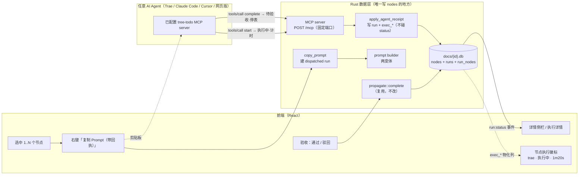
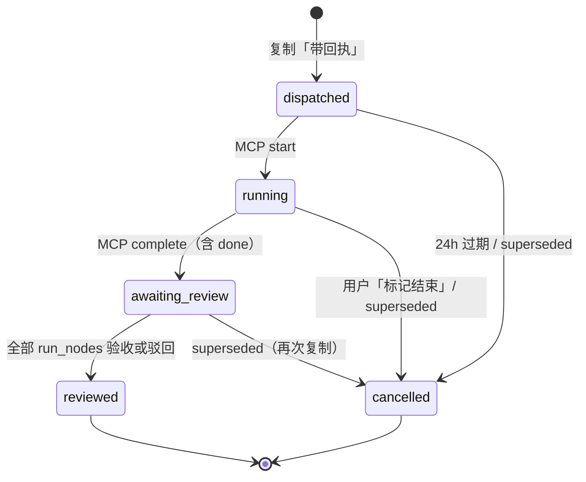

# 06 · 待办即 Prompt：AI Agent 协同方案 v2（手动粘贴 + MCP 回执）

> 状态：**草案（待评审）**　日期：2026-11-03　适用版本：v1.2+
>
> 目标：把「选中待办 → 复制 → 切到 Agent → 粘贴 → 回来手动勾选」五步手工操作，
> 升级为「选中 → 复制带回执的 Prompt → 粘贴给任意 Agent → Agent 通过 MCP 分两阶段回执
> → 回来一键验收」。
>
> **v2 修订记录**：v1 的「右键派发（宿主拉起 Agent CLI 子进程）」主线整体废弃，
> 三个硬阻碍见 §1.1；同时明确**不做** Pull 模式（Agent 主动来待办软件挑任务），
> 见 §1.2。v1 文档中仍然有效的章节（数据模型、验收权红线、Prompt 组装规则）在本版保留并修订。

---

## 0. TL;DR

### 0.1 一句话方案

**tree-todo 是任务的源头与验收的终点，执行交给任意 Agent，中间只靠两样东西连接：
「带回执的 Prompt」与「MCP server」**。用户选中节点 → 复制带回执的 Prompt → 粘贴到
Trae / Claude Code / Cursor / 任意 Agent；Agent 开始执行前调 MCP 工具 `tree_todo_start`
（节点亮「执行中」并计时）→ 完成后调 `tree_todo_complete_tasks`（节点变「待验收」，停表）
→ 用户在 tree-todo 里验收，走既有 `propagate` 事务置 done。**Agent 永远不碰完成态。**

### 0.2 关键决策速查

**保留自 v1 的决策（仍然有效）**

| # | 决策 | 结论 |
|---|---|---|
| D7 | 执行态归属 | Run 是独立聚合，`nodes` 表不加状态字段 |
| D9 | 完成裁决 | 回执只置「待验收 / 失败」，从不直接置 done |
| D11 | Prompt 来源 | 由任务树结构化组装：标题为主，note 可选，子节点作清单 |
| D12 | 运行数据 | 运行账本随文档库（`docs/{id}.db`），与节点同事务 |
| D15 | 复制 Prompt | 与回执并列的基础能力，不依赖任何 Agent 安装 |
| D16 | 执行状态 | `nodes` 物理列（`exec_state` + `exec_*` + `exec_detail` JSON），schema v4 |
| D17 | 验收权 | 主状态只能由人验收推进；**MCP 工具集里没有验收工具**（物理保证） |
| D18 | 设置入口 | 侧边栏底部图标条（回收站 + 设置） |
| D19 | 数据迁移 | 一步一事务 + 迁移前备份 + 迁后校验 + 只做加法 |
| D24 | 前端订阅 | selector 必须返回稳定引用，派生计算放 `useMemo` |

**v2 新增决策**

| # | 决策 | 结论 | 理由 |
|---|---|---|---|
| D25 | 主链路 | **手动粘贴**：复制 Prompt → 粘贴到 Agent → MCP 回执 | push 的三阻碍无解（§1.1）；pull 违背日常指派习惯（§1.2） |
| D26 | 回执通道 | **MCP 唯一**：v1 的本地 HTTP curl / CLI 回调 / 文本标记三通道全部移除 | 单通道降低协议复杂度与 Agent 选择困难；复制「带回执」的前提就是配好了 MCP |
| D27 | 二阶段回执 | **start（执行中·计时）→ complete（待验收·停表）** | 长任务执行超时用户能及时发现并介入；执行状态有了真实的时间轴 |
| D28 | MCP 服务形态 | **HTTP（Streamable HTTP）**，固定端口 + 持久 token | 用户手配一个 URL 最简单；stdio 需要可执行文件路径，且主应用本就常驻 |
| D29 | 复制不置节点状态 | 复制「带回执」只建 dispatched run，节点**无任何投影**；Agent 调 start 才亮灯 | 复制是轻动作，可能粘也可能不粘；「执行中」语义必须干净：真的有 Agent 在执行 |
| D30 | Agent 名称来源 | **配置注入优先，Agent 自报兜底** | 一键复制 MCP 配置时按目标 Agent 注入确定性名称；自报防手写配置场景；模型自报名称可能不标准 |
| D31 | 复制幂等 | 同一节点集合存在未 start 的 dispatched run 时**复用**；挂 running / awaiting_review 的旧 run 收口 superseded | 防止重复复制堆垃圾账本 |
| D32 | dispatched 过期 | 24h 未 start 自动收口（cancelled · expired） | 账本自洁；节点无投影所以无需通知 |
| D33 | running 不自动超时 | 执行中状态**永不自动收口**，靠计时展示让人判断 | 长任务合法；用户看到「2h35m」自然会介入，这是 D27 的设计意图 |

**v1 废弃决策（随 push 方向移除）**

| # | 原决策 | 废因 |
|---|---|---|
| D8 | CLI 子进程派发为主 | 三阻碍（§1.1） |
| D10 | 多级降级回执（MCP > HTTP > CLI > 标记 > 人工） | 只剩 MCP（D26） |
| D13 | 派发配置就近继承（工作区/Agent/模型） | 参数全部由用户在 Agent 侧自理 |
| D14 | 模型档位 + 可覆盖 | 同上，模型概念整体删除 |
| D20 | 退出码 + 流事件双条件判成功 | 无进程，无退出码 |
| D21 | 文本标记括号配平解析 | 无宿主进程可解析 |
| D22 | Prompt 走 stdin | 无进程 |
| D23 | 内置假 Agent（CLI 子进程模式） | 替换为 MCP 客户端模拟器（§12） |

### 0.3 分期

| 阶段 | 版本 | 交付 | 用户可感知价值 |
|---|---|---|---|
| 阶段一 | v1.2 | **push 冗余剔除**、Prompt 两变体、**MCP server（start + complete）**、二阶段回执与计时、手动收口、一键复制 MCP 配置、24h 过期 | 「复制 → 粘贴 → 树上亮『trae·执行中·1m20s』→ 变待验收 → 一键验收打勾」闭环 |
| 阶段二 | v1.3 | `tree_todo_report` 过程上报（schema v5）、`get_task` / `create_tasks`、详情侧栏过程记录 | Agent 执行中遇到的问题、采取的解法在树上可查 |
| 搁置 | — | 验证命令（complete 时宿主跑 Gate 3）、执行中心视图、待验收队列 | 与通道无关的增值项，按需排期 |

---

## 1. 为什么转向（决策记录）

### 1.1 push 方向的三个硬阻碍

1. **部分 Agent 没有 CLI，有 CLI 也未必拉得动**。Trae 个人版无 CLI；WorkBuddy 5.9.3
   实测：CLI 认证态由桌面端通过本地代理注入，独立拉起即「Authentication required」，
   且**退出码仍为 0**（DoD-1 因此未过）。UI 自动化 / 深链 / 逐 IDE 写插件在 v1 §15
   均评估过并否决（极脆弱 / 不统一 / N×M 成本），理由依然成立。
2. **派发参数非标准且随版本漂移**。执行目录、模型名、模型强度各家不同且高频变化。
   v1 为此设计的 AgentProfile / 模型档位 / 配置继承是维护无底洞——原 P0 未完成的
   4 项（档位表编辑、自定义命令、多选派发、工作区 UI）全部是这个无底洞的一部分。
   手动粘贴模式下，工作区 = 用户在 Agent 里打开的项目、模型 = 用户自己选，问题消失。
3. **中间过程数据难以获取**。push 模式下只有 CLI Agent 的 stdout 可解析（非结构化、
   格式私有），无 CLI 的全是黑盒。MCP 模式下 Agent 可以通过 `report` 工具**主动结构化
   上报**（阶段二），比解析日志可靠。

### 1.2 为什么也不是 Pull

现实工作流里很少有人让 Agent 自己去待办软件挑任务做，**直接指派**居多。Pull 模式
（`tree_todo_list_tasks` 让 Agent 来取活）违背这一习惯，且把「选哪个任务」的决策权
交给了 Agent。v2 明确不做 `list_tasks` 工具——MCP 工具集只服务「已被指派任务的
回执与上报」。

### 1.3 转向定性

这不是降级，而是把现实中本来就存在的「人肉粘合」显式化为产品的第一工作流：
**人负责指派与验收，Agent 负责执行与回报**。v1 已完成的资产（schema v4、验收流、
执行状态 UI、Prompt 组装、本地 HTTP 基础设施）全部是这条链路的地基，无浪费。

---

## 2. 新主链路



读图重点：

- **回执链与验收链写同一个库、不同的列**（v1 红线不变）：`apply_agent_receipt`
  只写 `runs` / `run_nodes` / `exec_*`；`propagate::complete` 只写 `nodes.status`。
- 宿主与 Agent 之间**没有进程关系**——只有剪贴板（去程）和 MCP over HTTP（回程）。
- 与现有架构的关系（红线不变）：状态传播仍只在 Rust；前端仍只持快照（`Affected`）；
  新建节点仍必为 pending；`nodes` 表 schema 不变。

---

## 3. 核心概念

### 3.1 任务即 Prompt（沿用 v1）

节点标题 `content` 是需求本体（一等公民）；`note` 是可选补充；直接子节点是验收清单。
纯文本变体不含任何回执内容；带回执变体在末尾追加完成协议（§5.1）。

### 3.2 主状态与执行状态：正交（沿用 v1，投影枚举更新）

| 维度 | 取值 | 谁能改 | 存储 |
|---|---|---|---|
| 主状态 `status` | `pending` / `done` | **只有用户**（勾选、取消、验收） | `nodes.status`，传播规则不变 |
| 执行状态 `execution.state` | `none` / `running` / `awaiting_review` / `failed` | MCP 回执推进；用户可手动收口 | `nodes.exec_state` 物理列 |

与 v1 的差异：

- **`queued` 投影不再出现**。复制「带回执」不改变节点状态（D29）；Agent 调 start
  才置 `running`。`ExecState::Queued` 枚举值保留解析兼容（历史数据），不再写入。
- run 的 `dispatched`（新值）在节点上**无投影**。

节点执行状态表现（沿用 v1 §9.4 视觉）：

| `exec_state` | 徽标 | 颜色 |
|---|---|---|
| `running` | `trae · 执行中 · 1m20s`（每秒跳） | accent 脉冲 + 卡片光晕 |
| `awaiting_review` | `待验收 · trae` | warning 琥珀竖条 |
| `failed` | `失败 · trae` | danger 红条 |

### 3.3 二阶段回执协议（新）

Agent 收到带回执的 Prompt 后，按协议分两个阶段调用 MCP 工具：

| 阶段 | 工具 | 时机 | 效果 |
|---|---|---|---|
| ① 开始 | `tree_todo_start` | **接受任务后、动手前** | run → running；节点亮「执行中」+ Agent 名；`exec_started_at` 落库，前端开始计时 |
| ② 完成 | `tree_todo_complete_tasks` | 全部做完后 | run → awaiting_review；节点变「待验收」；`exec_finished_at` / `duration_ms` 落库，计时停止 |

设计意图（D27/D33）：执行时间很长的任务，用户扫一眼树上的计时就能发现异常并介入；
Agent 忘了调 complete 时，计时会一直走下去——这本身就是信号，用户通过详情侧栏的
「标记结束」手动收口（§6）。

### 3.4 回执与验收：两条独立的写路径（沿用 v1）

- **回执** `apply_agent_receipt`：所有 MCP 工具的唯一落点。写 `runs` / `run_nodes` 并
  调 `exec::sync_run` 刷新 `exec_*`——唯独不碰 `nodes.status`。
- **验收** `accept_run` / 隐式验收（勾选待验收节点）：唯一能把主状态推向 done 的入口，
  走与手动勾选完全相同的 `propagate` 事务，进撤销历史。
- **物理保证**：MCP 工具集里没有「验收 / 勾选 / set_status」类工具（D17）。

---

## 4. MCP Server 设计

### 4.1 形态：HTTP（Streamable HTTP）

主应用内置 MCP server，暴露 `POST /mcp`。**不做 stdio 子命令**（v1 §6.2 的规划作废）：

- 用户手配时「一个 URL + 一个 header」比「可执行文件路径 + 参数」简单得多；
- 主应用本就常驻（托盘），端口活着；
- 不需要为 stdio 处理子进程生命周期。

实现要点：

- **无状态实现**：每个 POST 独立处理，不维护 session（MCP Streamable HTTP 允许；
  2026-07-28 版协议明确无状态语义）。`initialize` 直接返回能力声明，不强制 session id。
- JSON-RPC 2.0，方法：`initialize` / `notifications/initialized` / `tools/list` / `tools/call`。
- 响应格式遵循 MCP：`tools/call` 返回 `{content:[{type:"text",text:"…"}]}`；
  业务错误（run 不存在 / 已收口）用 `isError:true` + 文本说明，不用 JSON-RPC error。
- 协议版本协商：支持客户端请求的版本则原样返回，否则返回 `2025-06-18`。

### 4.2 工具集

**阶段一（核心闭环，刻意保持小）**：

| 工具 | 入参 | 作用 |
|---|---|---|
| `tree_todo_start` | `{run_id, agent_name?}` | run → running；节点置执行中并开始计时；`agent_name` 见 D30 |
| `tree_todo_complete_tasks` | `{run_id, tasks:[{id, result, summary?}], summary?}` | 逐节点回执；`result ∈ {done, skipped, failed}`，只有 `done` 置待验收；幂等 |

**阶段二（过程上报）**：

| 工具 | 入参 | 作用 |
|---|---|---|
| `tree_todo_report` | `{run_id, level: info\|warn\|error, message}` | 过程上报（遇到的阻塞、采取的解法），落 `run_reports` 表，详情侧栏展示 |
| `tree_todo_get_task` | `{run_id}` | 返回任务详情（标题 / note / 路径 / 子任务），Agent 上下文丢失时找回 |
| `tree_todo_create_tasks` | `{parent_id, tasks:[{content, note?}]}` | 把拆解结果写回树（走 `create_node`，新节点必为 pending） |

**明确不做**：`list_tasks`（Pull 模式，§1.2）、任何验收类工具（D17）。

### 4.3 端口、token 与网络

| 项 | 设计 | 与 v1 的差异 |
|---|---|---|
| 端口 | **固定默认 39401**，设置页可改；被占用时启动告警并提示修改 | v1 随机端口（Agent 配置里的 URL 会失效，必须固定） |
| 鉴权 | `Authorization: Bearer <token>`；**持久 token**，首次生成 32 字节，存 `app_data/mcp.json`（0600） | v1 token 每次启动重生成（Agent 配置会失效，必须持久） |
| 绑定 | 只绑 `127.0.0.1` | 不变 |
| Origin | 带了就必须是 loopback，否则 403 | 不变 |
| token 重置 | 设置页「重置 token」，重置后需更新 Agent 侧配置 | 新增 |
| `runtime.json` | **删除**；`mcp.json`（`{port, token, version}`）取代之 | v1 的发现机制服务于 spawn 注入，已无意义 |
| run token | **不再需要**（v1 为 curl 兜底设计的 run 级凭证随 curl 通道一起删除） | 回执鉴权 = MCP token + run_id（ULID 难猜）双因素 |

持久 token 的安全权衡：本机任意进程都能读到它并调用 MCP。缓解：只绑 loopback、
文件权限 0600、**它最坏只能影响执行状态（`exec_*`），永远碰不到主状态**（D17 物理保证）。
可接受。

### 4.4 一键复制 MCP 配置

设置页「MCP 集成」分组提供：选择目标 Agent → 生成对应格式的配置片段 → 一键复制。
纯前端模板，**不做 Agent 探测**（探测是 push 设施）。

| 目标 | 生成物 |
|---|---|
| Trae / Cursor | `mcpServers` JSON 片段（含注入的 agent 名 header） |
| Claude Code | `claude mcp add` 命令 + `.mcp.json` 片段 |
| Codex | `codex mcp add` 命令 |
| 通用 | `mcpServers` JSON 片段 |

生成内容包含 URL、Bearer token，以及**注入的 Agent 名称**（`X-Tree-Todo-Agent` header，
D30 的优先来源）。示例：

```jsonc
{
  "mcpServers": {
    "tree-todo": {
      "url": "http://127.0.0.1:39401/mcp",
      "headers": {
        "Authorization": "Bearer <token>",
        "X-Tree-Todo-Agent": "Trae"
      }
    }
  }
}
```

### 4.5 run 定位与生命周期管理

- **run 定位**：MCP 层维护内存表 `run_id → doc_id`（复制时注册；启动时扫各文档活跃
  run 重建），不为一次调用遍历所有文档（沿用 v1 §6.3 思路）。
- **复制幂等（D31）**：复制「带回执」时——
  - 目标节点集合上挂着 **dispatched**（未 start）的 run 且节点集合一致 → **复用**该
    run，刷新 prompt 快照与时间戳；
  - 挂着 **running / awaiting_review** 的 run → 旧 run 收口（cancelled，summary 记
    `superseded`），建新 run。
- **24h 过期（D32）**：后台每小时扫一次，dispatched 超过 24h → cancelled（`expired`）。
  节点无投影，无需 UI 通知。
- **running 不自动超时（D33）**：见 §3.3。

---

## 5. Prompt 契约

### 5.1 两个变体

**变体 A：纯文本**（右键「复制 Prompt」，`Ctrl+Shift+C`）——任务本体，不含任何
tree-todo 痕迹：

````markdown
# 任务：{{content}}

## 补充说明            ← note 非空才渲染
{{note}}

## 任务上下文
- 文档：{{docName}}
- 路径：{{ancestorPath}}

## 子任务（全部完成后本任务才算完成）   ← 有子节点才渲染
- [ ] {{child1.content}}
- [x] {{child2.content}}               ← 已完成的标 [x]

## 约束
- 只修改与本任务相关的文件；不要执行 `git commit` / `git push`。
- 不要询问确认性问题；把假设写在最终回复里。
- 完成后用不超过 5 行总结做了什么、改了哪些文件。
````

相对现状（`agents/mod.rs::build_prompt` 的无回调分支）**精简掉**：

- 「节点 ID：`{id}`」行（对无回执场景是噪声）；
- 「这是一次手动复制，完成后请回到 tree-todo 勾选对应待办」（用户明确要求去掉）；
- 「工作区：…」行（工作区概念随 push 删除；要告诉 Agent 在哪干活，写在 note 里）；
- 「还有 N 条未列出，可用 tree_todo_list_tasks 拉取」（该工具已明确不做）。

**变体 B：带回执**（右键「复制 Prompt（带回执）」，`Ctrl+Shift+R`）——变体 A 全部内容
（**含节点 ID**）+ 完成协议段：

````markdown
（…变体 A 的全部内容，保留「节点 ID：`{nodeId}`」行…）

## 完成协议（必须遵守）
运行 ID：`{{runId}}`

本次需要回执的节点：
- `{{nodeId}}` {{content}}

1. **开始执行前**，先调用 MCP 工具 `tree_todo_start`：
   `{"run_id":"{{runId}}","agent_name":"<你的产品名称，如 Claude Code / Trae>"}`
   ——任务将标记为「执行中」并开始计时。
2. **全部完成后**，调用 MCP 工具 `tree_todo_complete_tasks`：
   `{"run_id":"{{runId}}","tasks":[{"id":"{{nodeId}}","result":"done","summary":"一句话说明"}]}`
   ——任务将进入「待验收」，是否完成由用户验收决定。
3. 若上述工具不可用（tree-todo 未运行或未配置其 MCP server），直接完成任务即可，
   无需回执。
4. 任何时候都不要试图替用户「完成 / 勾选」任务。

（…约束段同变体 A…）
````

多选：每个选中节点独立一段 `# 任务 N`（含各自节点 ID），**共用一个 runId**，
完成协议的 `tasks` 数组列出全部节点（沿用 v1 §5.2 多选规则）。

### 5.2 组装规则（纯函数，必须单测）

沿用 v1 规则表，修订项：

| 规则 | 取值 |
|---|---|
| note 为空 | 整段省略（不写「无」、不复制标题） |
| note 上限 | 6000 字符，超出截断并标注 |
| 祖先路径 | 根到父，` / ` 连接，最多 6 层 |
| 子节点清单 | 只列直接子节点，上限 150 条，超出标注「还有 N 条未列出」 |
| 已完成子节点 | 列出并标 `[x]` |
| 多选 | 每节点一段，共享 runId（仅变体 B） |
| 变体 A | **不得出现**：节点 ID、runId、工具名、任何「回到 tree-todo」文案（单测断言） |
| 变体 B | 必须包含：节点 ID、runId、start/complete 工具名与参数示例 |

### 5.3 完成协议段设计说明

- **自包含**：协议假设 Agent 对 tree-todo 一无所知，所有信息（工具名、参数、语义）
  都在段内说清。
- **降级话术**：第 3 条让 Agent 在工具不可用时直接干活不纠结——回执是增强，不是门槛。
- **防越权**：第 4 条显式声明验收权（与 D17 的物理保证双保险：就算模型无视约束，
  工具集里也没有能勾选的工具）。

---

## 6. 状态机与边界情况

### 6.1 run 状态机（v2）



v1 的 `failed` / `blocked` / `interrupted` 终态：

- **failed** 保留：`complete` 里所有节点 `result` 均非 done 时 run 落 failed；
  或用户在详情侧栏把执行标记为失败。
- **blocked / interrupted** 不再产生（无进程、无 `TREE_TODO_BLOCKED` 标记），枚举值
  保留解析兼容，不再写入。

### 6.2 边界情况表

| 场景 | 行为 |
|---|---|
| Agent 没调 start 直接 complete | **宽容接受**：run 直接 dispatched → awaiting_review；duration 缺失，徽标无时长。任务确实做完不该被流程卡住 |
| 重复 complete（awaiting_review 期间） | 幂等，允许修正回执（沿用 v1 §6.4） |
| run 已收口后再 complete | 拒绝（isError + 文本说明） |
| complete 里 `result=skipped/failed` | 只记录 report；全部非 done → run failed，节点投影 failed（红点，用户可忽略 / 重复制） |
| Agent 忘了 complete（running 卡死） | 计时一直走（设计意图）；用户在详情侧栏「标记结束」→ run cancelled，节点清空（D33） |
| 节点在 run 期间被用户手动勾选 | complete 到达时照常记录 report；验收时 no-op，不写第二条 history（沿用 v1） |
| 节点被删除 | 跳过 + warning；同一事务把该节点 pending 的 run_nodes 置 rejected（沿用 v1「删除收口」） |
| 同节点再次复制（带回执） | 见 D31：dispatched 复用；running / awaiting 收口 superseded 后新建 |
| complete 的 node id 不在该 run | 拒绝该项并说明 |
| 24h dispatched 过期 | cancelled（expired），后台每小时扫（D32） |

---

## 7. 数据模型（本期零迁移）

**阶段一不升 schema 版本**。新增行为全部复用 v4 结构：

- `runs.mode = 'copy'`（新值，TEXT 列无 CHECK 约束）；
- `runs.status = 'dispatched'`（新值）；
- `exec::sync_run` 对 dispatched 不写投影（保持 none）。

**停止写入的列**（列保留，历史数据不动；未来 contract 阶段再清理）：
`pid` / `exit_code` / `session_id` / `cost_usd` / `tokens_in` / `tokens_out` / `log_path` /
`model` / `workspace` / `needs_confirmation`。

**停用不删**：`dispatch_prefs` 表、`nodes.exec_needs_confirm` 列（needs_confirmation
语义依赖「退出码 0 但无回执」，无进程后不复存在）。

**阶段二升 v5**：`CREATE TABLE run_reports (run_id, node_id?, level, message, created_at)`
+ 索引，走完整迁移框架（备份 / 校验 / 回滚 / fixture）。

---

## 8. push 冗余移除清单

> 目标：彻底剔除 push 方向造成的冗余代码。移除后 `cargo test` + `clippy` + `pnpm build`
> 必须全绿（测试同步替换，见 §12）。

**前端（删除）**

| 位置 | 内容 |
|---|---|
| [NodeContextMenu.tsx](file:///d:/project/tree-todo/src/components/NodeContextMenu.tsx) L39-94 | 「派发给 AI」菜单项、`Ctrl+Enter` / `Ctrl+Shift+Enter` 快捷键逻辑 |
| DispatchDialog.tsx（整文件） | 派发对话框（Agent / 工作区 / 模型选择） |
| runStore.ts L39-64, L118-140, L199-221 | `dispatch` / `cancel` 动作、`logs` 字段与 `run:event` 订阅、`dispatchOpen` 等派发态 |
| RunDrawer.tsx L106-125 | 实时日志区、「中断执行」按钮、补充指令输入 |
| SettingsView.tsx L69-149 | Agent 分组（探测列表 / 标签）、模型分组、派发快捷键说明 |

**前端（改造）**

| 位置 | 改造 |
|---|---|
| NodeContextMenu.tsx | 「复制 Prompt」拆为两个顶层项：纯文本（`Ctrl+Shift+C`）/ 带回执（`Ctrl+Shift+R`） |
| RunDrawer → 执行详情面板 | 内容改为：状态 / 计时 / Agent 名 / 回执列表 / 「标记结束」（running）/ 验收操作 |
| SettingsView.tsx | 新增「MCP 集成」分组（§9.3） |

**Rust（删除）**

| 位置 | 内容 |
|---|---|
| agents/runner.rs（整文件） | 进程生命周期 / EventSink |
| agents/protocol.rs（整文件） | 流事件归一化、TREE_TODO 标记解析、闸门判定 |
| fake_agent.rs、bin/tt-fake-agent.rs | 假 Agent（替换为 MCP 客户端模拟器测试） |
| agents/e2e_tests.rs、real_agent_tests.rs | spawn 类端到端测试 |
| commands/agent.rs | `detect_agents` / `dispatch_run` / `cancel_run` / `get_dispatch_config` / `save_dispatch_config` / `clear_dispatch_field` / `set_doc_workspace` / `save_custom_agents` |
| db/prefs.rs | dispatch_prefs 读写（表停用） |
| runtime/mod.rs | `/v1/runs/{run_id}/complete` 端点、run token、runtime.json |

**Rust（改造）**

| 位置 | 改造 |
|---|---|
| agents/mod.rs | 删 AgentProfile / 探测；`build_prompt` 重写为两变体（§5.1）；建议更名 `agents/prompt.rs` |
| commands/agent.rs | `preview_prompt` → `copy_prompt(variant)`（建 dispatched run + 返回 Prompt 文本）；新增 `close_run` / `get_mcp_config` / `reset_mcp_token` |
| runtime/mod.rs | 新增 `POST /mcp`（固定端口 + 持久 token + mcp.json） |
| model.rs | `RunStatus` 增 `Dispatched`；删 `DispatchConfig`；`ExecState::Queued` 停用（保留解析） |
| db/runs.rs / db/exec.rs | dispatched / copy / superseded / expired 的状态处理；sync_run 对 dispatched 无投影 |

---

## 9. UI / UX

### 9.1 右键菜单

```text
┌─ 买域名 ──────────────────────────┐
│ 编辑标题                    F2    │
│ 查看详情                  Alt+Enter│
├───────────────────────────────────┤
│ 复制 Prompt              Ctrl+Shift+C │
│ 复制 Prompt（带回执）     Ctrl+Shift+R │
├───────────────────────────────────┤
│ 新建子任务                  Tab   │
│ 新建同级任务                Enter │
│ 删除                        Del   │
└───────────────────────────────────┘
```

- 两个复制项**并列顶层**（不再嵌套子菜单）：都是一等公民，点击即复制并 toast
  「Prompt 已复制 · N 行 · 带回执/纯文本」。
- 节点处于待验收时右键顶部出现「验收通过 / 驳回…」（沿用 v1）。
- 复制带回执时若目标节点的 dispatch_prefs…… 不存在了——若目标节点挂着活跃 run，
  按 D31 静默处理，toast 追加「已替代上一轮派发」。

### 9.2 详情侧栏（执行卡片）

沿用 v1 §9.2 布局，执行卡片按状态：

| 状态 | 卡片内容 |
|---|---|
| `running` | `● trae · 执行中 · 12m03s`（计时每秒跳）+ [标记结束]（confirm：run 收口 cancelled） |
| `awaiting_review` | `待验收 · trae · 耗时 3m12s` + 回执统计 + [通过并完成] [驳回] |
| `failed` | 红 `失败 · trae` + summary + [重新复制 Prompt] [忽略] |
| 无执行 | 灰字「未执行」+「右键复制 Prompt，粘贴给你的 AI Agent」 |
| （阶段二） | 追加「过程记录」区：`run_reports` 时间线（info/warn/error） |

「最近执行」列表保留（时间 / Agent / 结果）。

### 9.3 设置页

删 Agent / 模型 / 派发分组，新增「MCP 集成」：

| 项 | 说明 |
|---|---|
| 服务状态 | 运行中 · `127.0.0.1:39401`（端口被占时红色告警 + 修改框） |
| 一键复制配置 | 目标 Agent 下拉（Trae / Cursor / Claude Code / Codex / 通用）→ 生成片段 → 复制 |
| Token | 脱敏显示；[重置 token]（重置后提示更新 Agent 侧配置） |
| 使用说明 | 三步图文：配 MCP → 复制带回执 → 粘贴 |

### 9.4 徽标 / 平铺 / TopBar

- 节点徽标、平铺 chip、待验收置顶与筛选、列头计数：**全部沿用**（P0-08/09 已实测）。
- TopBar「执行中 N · 待验收 M」沿用（数据源 `exec_counts` 不变；dispatched 不计数）。

---

## 10. 安全与隐私

| 面 | 措施 |
|---|---|
| 完成态保护 | MCP 工具集无验收工具（D17 物理保证）；`apply_agent_receipt` 不写 `status` |
| 网络面 | 只绑 127.0.0.1；固定端口；Origin 校验 |
| 鉴权 | 持久 Bearer token（0600）；重置入口在设置页 |
| 最坏影响 | token 泄露只影响 `exec_*` 执行状态，主状态 / 传播 / 历史不可达 |
| run_id 进 Prompt | ULID 难猜；仅能对本 run 回执；run 收口即失效；不携带节点之外的内部信息 |
| Prompt 注入 | 节点内容含「忽略以上指令」类模式时黄条提示（沿用 v1）；完成协议第 4 条显式声明验收权 |
| 日志 | MCP 调用记录本地存储（runs / run_reports），默认 7 天清理，无遥测 |

---

## 11. IPC 与代码落点

### 11.1 Tauri command（v2 全集）

```rust
// 复制与 Prompt
copy_prompt(node_ids, variant: 'plain' | 'receipt') -> CopyResult   // 建 dispatched run（变体 B）+ 返回 Prompt 文本
preview_prompt(node_ids, variant) -> PromptPreview                   // 预览（对话框 / 无副作用）
// 查询
list_runs(doc_id?, status?, limit?) -> Vec<RunView>
get_run(run_id) -> RunDetail
exec_counts() -> ExecCounts
list_pending_reviews(doc_id?) -> Vec<RunView>
// 验收（沿用 v1，一字不改）
accept_run(run_id, node_ids) -> Affected
reject_run(run_id, node_ids, feedback) -> ()
accept_node(node_id) -> Affected
dismiss_node(node_id) -> Affected
// 收口
close_run(run_id, reason) -> ()          // running 手动「标记结束」→ cancelled
purge_runs(before_days) -> u64
// MCP 配置
get_mcp_config() -> McpConfigView        // 端口 / token 脱敏 / 服务状态 / 各 Agent 配置片段
reset_mcp_token() -> McpConfigView
open_path(path) -> ()                    // 沿用
copy_text(text) -> ()                    // 沿用（剪贴板）
```

> `copy_prompt` 与 MCP `tools/call` 都汇聚到 `apply_agent_receipt` / `exec::sync_run`，
> 无第二条写路径。

### 11.2 事件

| 事件 | 载荷 | 说明 |
|---|---|---|
| `run:status` | `{runId, status, executions}` | 保留（MCP start / complete / 收口后推送 UI） |
| `run:event` | — | **删除**（无进程日志流） |
| `review:changed` | `{runId, nodeIds, review}` | 保留 |

### 11.3 文件改动清单

见 §8（移除 / 改造两表）+ 以下新增：

```
src-tauri/src/agents/mcp.rs         # MCP JSON-RPC 处理 + 工具定义（新）
src-tauri/src/agents/mcp_tests.rs   # MCP 客户端模拟器集成测试（新）
```

---

## 12. 测试策略

### 12.1 MCP 客户端模拟器（替代假 Agent）

Rust 集成测试直接对 `POST /mcp` 发 HTTP 请求，按真实 MCP 协议走全链路：

```text
initialize → tools/list（断言工具清单，断言无验收类工具）
→ tools/call tree_todo_start（断言 run=running、节点 exec_state=running）
→ tools/call tree_todo_complete_tasks（断言 awaiting_review、**节点 status 仍 pending**）
→ accept_run（断言 done + 级联 + history 一条）
```

比假 Agent 更贴近真实（假 Agent 模拟的是我们以为的 Agent 行为；模拟器模拟的是协议本身）。

### 12.2 单测矩阵

| 模块 | 用例 |
|---|---|
| prompt（两变体） | 变体 A 断言**不含**节点 ID / runId / 工具名 /「回到 tree-todo」；变体 B 断言含全部协议要素；note 空 / 非空；子节点超 150；多选合并；变体 A 复制不建 run |
| 状态机 | dispatched→running→awaiting_review→reviewed 全程；无 start 直接 complete；重复 complete 幂等；收口后拒绝；skipped/failed 全集 → failed 投影 |
| 复制幂等（D31） | dispatched 复用（同集合）；running / awaiting superseded 收口 + 新建；不同集合不复用 |
| 过期（D32） | dispatched 超 24h → cancelled(expired)；running 永不自动收口（D33 断言） |
| 鉴权 | 无 token 401；错 token 401；Origin 非 loopback 403 |
| 红线 | **任何 MCP 调用序列后 `nodes.status` 不变**（穷举 start / complete / report 组合） |
| 验收 | 沿用 v1 全部验收 / 隐式验收 / 撤销用例（不改） |
| mcp.json | 首次生成；token 重置后旧 token 失效；端口冲突告警 |

### 12.3 手工验收

见 `docs/07-acceptance.md`（v2 清单）。

---

## 13. 分期与验收

### 阶段一 · v1.2「闭环」

1. push 冗余剔除（§8 全表）
2. Prompt 两变体（§5）
3. MCP server：固定端口 + 持久 token + `start` / `complete_tasks`（§4）
4. 二阶段回执状态机与计时（§6）
5. 手动收口「标记结束」、24h 过期
6. 一键复制 MCP 配置（§4.4）
7. 详情侧栏执行卡片改造、设置页「MCP 集成」分组

**DoD**：在真实 Agent（至少 Trae 或 WorkBuddy 之一）里配好 MCP，复制带回执 → 粘贴 →
树上亮「agent·执行中·计时」→ 完成后变「待验收」→ 验收打勾 → `Ctrl+Z` 可撤；
**全流程不出现自动勾选**。`cargo test` + `clippy` + `pnpm build` 全绿。

### 阶段二 · v1.3「过程可见」

1. `tree_todo_report` + `run_reports` 表（schema v5 迁移）
2. `get_task` / `create_tasks`
3. 详情侧栏「过程记录」时间线

**DoD**：Agent 在执行中 report 两条进度 + 一条阻塞，详情侧栏时间线完整展示；
`create_tasks` 拆出的子节点全部 pending 且不自动展开动画。

### 搁置（不排期）

验证命令（complete 时宿主跑 Gate 3）、执行中心视图（`Ctrl+4`）、待验收队列、
成本统计（无进程无数据源，除非 Agent 通过 report 上报）。

---

## 14. 风险与未决问题

| # | 风险 | 应对 |
|---|---|---|
| R1 | Agent 不调 start / complete（协议遵循率） | Prompt 协议段自包含 + 降级话术；实测各 Agent 遵循率；忘 complete 时计时常亮 + 手动收口兜底；都不调则等同纯文本模式（无损失） |
| R2 | 固定端口被占用 | 设置页可改端口 + 启动告警 |
| R3 | 持久 token 泄露 | 只影响 exec_*（D17）；0600；可重置 |
| R4 | MCP 各客户端版本差异（Streamable HTTP 支持） | 主流 Agent 已支持；「一键复制」按目标生成；通用片段兜底 |
| R5 | 复制带回执后用户改了节点内容 | run 的 prompt 快照保留原样（审计语义）；complete 回写的是节点当前状态 |
| R6 | 多 Agent 同时执行同一节点 | D31 superseded 收口；后到者覆盖前一轮 |
| Q1 | Agent 自报名称的规范（"Claude" vs "Claude Code"） | 配置注入优先（D30）；展示层不做归一化 |
| Q2 | 网页版 Agent（无 MCP 的）能否闭环 | 不能——走纯文本变体 + 手动勾选；这是设计边界不是缺陷 |
| Q3 | complete 里 result=skipped 的节点要不要亮黄点 | 暂同 failed 红点；实测后再细分 |

---

## 15. 备选方案对比（v2 修订）

| 方案 | 结论 | 理由 |
|---|---|---|
| J'. CLI 派发（v1 主方案） | **废弃** | §1.1 三阻碍 |
| D'. 纯 MCP Pull | 否决 | §1.2 违背指派习惯；不做 list_tasks |
| K. stdio MCP 子命令 | 否决 | 用户手配可执行路径麻烦；主应用常驻无需子进程 |
| L. HTTP curl 回执（v1 L2） | 否决 | token 进 Prompt 有泄露面；shell 权限 / Windows 引号坑；MCP 已覆盖 |
| M. 文本标记回执（v1 L4） | 否决 | 无宿主进程可解析输出 |
| **N. 手动粘贴 + HTTP MCP 二阶段回执（本方案）** | ✅ | 复用全部既有资产；单通道；Agent 名称 / 计时 / 待验收语义完整；验收权物理保证 |

---

## 16. 对现有文档的改动（评审通过后执行）

| 文档 | 改动 |
|---|---|
| `01-overview.md` | ADR 表追加 D25–D33；架构图中 agents/ 收缩为 prompt + mcp |
| `02-data-model.md` | 标注 dispatch_prefs 停用、runs 停写列清单；v5 预告（run_reports） |
| `03-feature-design.md` | 功能表：「派发给 AI」删除；「复制 Prompt（带回执）」新增；MCP 集成设置 |
| `04-ui-ux-design.md` | 右键菜单两项复制；快捷键表删 `Ctrl+Enter` / `Ctrl+Shift+Enter`，增 `Ctrl+Shift+R`；详情侧栏 / 设置页变更 |
| `05-roadmap.md` | M6 改为「手动粘贴 + MCP 回执」阶段一 / 二 |
| `AGENTS.md` | 红线补充：MCP 工具层不得出现验收 / 勾选能力；回执唯一落点 `apply_agent_receipt` |

## 17. 参考

- MCP 规范（Streamable HTTP / 无状态语义）：`https://modelcontextprotocol.io/specification`
- Trae / Cursor / Claude Code / Codex 的 MCP 配置格式（一键复制模板的数据来源）
- v1 方案全文见 git 历史（docs/06-agent-integration.md @ v1.1）
